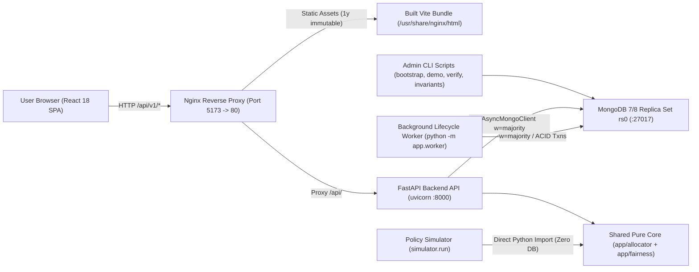
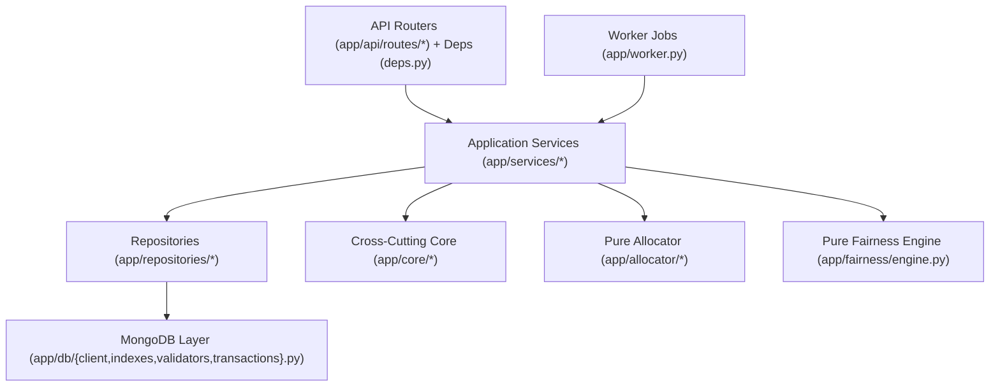
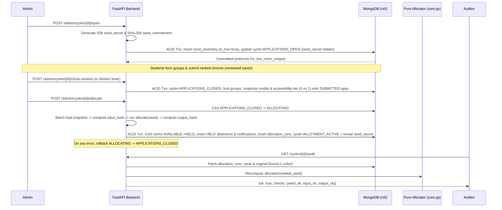
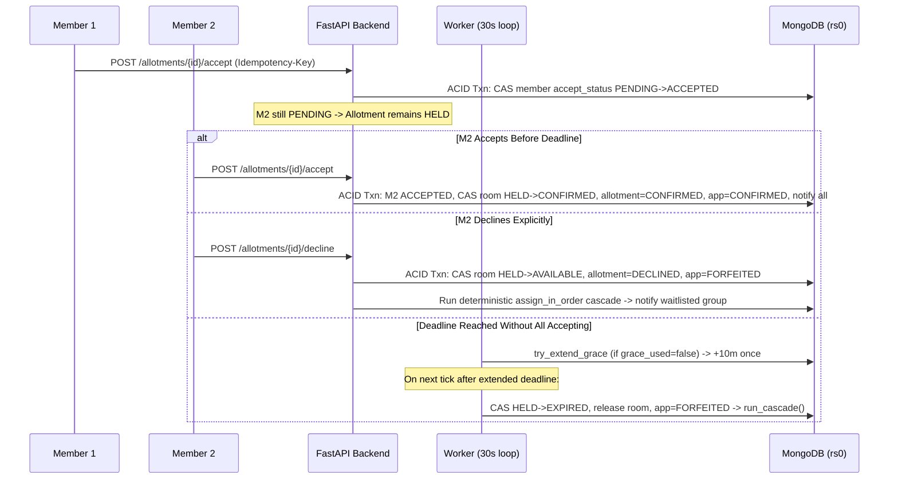

# System Architecture & Design

FairNest is structured as a **layered modular monolith** paired with a **dedicated background worker**, a **React 18 Single Page Application (SPA)**, a **replicated MongoDB database (`rs0`)**, and a **pure-core-sharing simulation suite**. This architecture delivers strong ACID consistency, clean domain boundaries, and zero algorithmic drift between online allocation and offline fairness experiments without the distributed-transaction overhead of microservices.

---

## 1. High-Level Deployment & Runtime Topology

### Runtime Containers & Processes

| Component | Entrypoint | Exposed Port | Responsibility | Source |
|---|---|---|---|---|
| **MongoDB (`mongo`)** | `mongod --replSet rs0` | `27017` | Persistent store across 20 collections, partial unique indexes, TTL cleanup, `$jsonSchema` validation, multi-document ACID transactions. | [docker-compose.yml](../docker-compose.yml) |
| **FastAPI API (`backend`)** | `uvicorn app.main:app` | `8000` | HTTP JSON API under `/api/v1`, JWT auth, rate limiting, RBAC & hostel scope enforcement, idempotency, transactional mutations. | [main.py](../backend/app/main.py) |
| **Lifecycle Worker (`worker`)** | `python -m app.worker` | — | Autonomous 30-second loop: +10m hold grace, hold expiry + cascade, scheduled window open/close, cycle auto-close, 10-minute invariant checks. | [worker.py](../backend/app/worker.py) |
| **Frontend Proxy (`frontend`)** | `nginx:alpine` | `5173` → `80` | Serves SPA bundle with `try_files` HTML5 fallback, `1y` immutable asset caching, and reverse-proxies `/api/` to `http://backend:8000`. | [nginx.conf](../frontend/nginx.conf) |
| **Policy Simulator (`simulator`)** | `python -m simulator.run` | — | Offline Monte Carlo evaluation of policies (`random`, `credit_weighted`, `min_credit`, `max_credit`, `static_priority`, `fcfs`) across scenarios `S1`–`S8`. | [run.py](../simulator/simulator/run.py) |

> [!NOTE]
> The backend and worker run from the **same Docker image** (`backend/Dockerfile`) built as a multi-stage `python:3.11-slim` image and running under a non-root user (`appuser`, UID `1001`).

---

## 2. Backend Internal Modular Monolith Architecture

Inside `backend/app/`, dependencies point strictly inward from transport adapters toward pure domain logic:

### Module Responsibilities

1. **Transport Layer ([`app/main.py`](../backend/app/main.py), `app/api/routes/*`, [`app/api/deps.py`](../backend/app/api/deps.py)):**
   - Thin route handlers parse path/query/JSON arguments, apply FastAPI dependencies (`get_current_user`, `current_student`, `current_warden`, `current_admin`, `current_auditor`, `current_super_admin`), validate hostel scope (`assert_staff_scope`, `assert_user_hostel_scope`), check `Idempotency-Key` headers on student workflow actions, and delegate to service functions.
   - `main.py` registers middlewares in stack order: `RequestIDMiddleware`, `SecurityHeadersMiddleware`, and `CORSMiddleware`, plus unified exception handlers for `AppError`, `RequestValidationError`, and unhandled `Exception`. (`TimingMiddleware` is also defined in [middleware.py](../backend/app/core/middleware.py) for latency instrumentation.)

2. **Service Layer (`app/services/*`):**
   - Orchestrates multi-step business workflows, ACID transaction scopes (`async with client.start_session() as session: await session.with_transaction(...)`), audit logging, and notification creation:
     - [auth_service.py](../backend/app/services/auth_service.py): Argon2id verification, lockout, refresh rotation & reuse revocation, session listing, password resets.
     - [user_service.py](../backend/app/services/user_service.py): Student CSV upsert import and hierarchical email-based role grant workflows.
     - [catalogue_service.py](../backend/app/services/catalogue_service.py): Comma/newline room parser with `:capacity` overrides (`parse_room_entries`) and availability aggregation.
     - [cycle_service.py](../backend/app/services/cycle_service.py): Cycle state machine (`_VALID_TRANSITIONS`), `open_cycle_impl` (room inventory snapshot + seed commitment), `close_window_impl` (group lock + credit/tier snapshot), `schedule_cycle_impl`, `extend_window_impl`, `reopen_cycle_impl`, stats.
     - [group_service.py](../backend/app/services/group_service.py): Solo/multi-member group creation (max 4), invite lifecycle, eligibility checks, choice normalization (`ROOM`/`FLOOR`, max 10), optimistic concurrency save (`version`), submit, withdraw.
     - [allocation_service.py](../backend/app/services/allocation_service.py): Batched zero-N+1 snapshot loading, `preview_allocation` dry runs, atomic `run_allocation` with `ALLOCATING` lock + rollback guard, `verify_allocation` independent re-computation.
     - [allotment_service.py](../backend/app/services/allotment_service.py): Member `accept_allotment` (`HELD → CONFIRMED`), `decline_allotment` (`→ FORFEITED` + cascade), `cancel_allotment`, admin `revoke_allotment` (`reinsert=True` + 0 penalty), `extend_hold`, `manual_assign`, deterministic `run_cascade`, and idempotent `settle_cycle`.

3. **Repository Layer (`app/repositories/*`):**
   - [users.py](../backend/app/repositories/users.py), [catalogue.py](../backend/app/repositories/catalogue.py), [core_repos.py](../backend/app/repositories/core_repos.py): Encapsulates all PyMongo queries, atomic compare-and-swap transitions (`hold_room`, `confirm_room`, `release_room`, `transition_cycle_status`, `accept_member`, `try_extend_grace`), bounded cursor reads (`.to_list(length=...)`), and MongoDB aggregation pipeline updates (`apply_credit_delta`).

4. **Pure Domain Core ([`app/allocator/core.py`](../backend/app/allocator/core.py), [`app/allocator/verify.py`](../backend/app/allocator/verify.py), [`app/fairness/engine.py`](../backend/app/fairness/engine.py)):**
   - **Zero infrastructure imports** (no FastAPI, PyMongo, wall-clock calls, or global `random` state).
   - Accepts plain Python dataclasses/dicts and explicit `seed: bytes`, making core allocation and fairness rules 100% deterministic, fast to unit test, and directly reusable by `simulator/`.

5. **Database Layer (`app/db/*`):**
   - [client.py](../backend/app/db/client.py): Global `AsyncMongoClient(uri, w="majority", tz_aware=True)`.
   - [indexes.py](../backend/app/db/indexes.py): Idempotent creation of all compound, unique, partial unique, sparse, and TTL indexes at API and worker startup.
   - [validators.py](../backend/app/db/validators.py): `$jsonSchema` server-side enforcement on `room_inventory` (`validationLevel="moderate"`, `validationAction="error"`).
   - [transactions.py](../backend/app/db/transactions.py): Transaction wrapper for retryable multi-document commits.

---

## 3. Frontend SPA & Security-First Session Architecture

The frontend (`frontend/src/`) is a Vite-bundled React 18 application styled with Material UI v5 ([theme.js](../frontend/src/styles/theme.js)):

- **Routing & Role Isolation ([`App.jsx`](../frontend/src/App.jsx), [`RoleRoute.jsx`](../frontend/src/auth/RoleRoute.jsx)):**
  - Public routes (`/login`, `/activate`, `/forgot`, `/reset`) render without shell chrome.
  - Protected routes wrap `<AppShell />` inside `<RoleRoute roles={[...]} />`, and `/` delegates to `<RoleHome />` which redirects to the role's primary workspace (`/student`, `/warden`, `/admin`, `/auditor`, `/superadmin`).
- **State & Caching ([`main.jsx`](../frontend/src/main.jsx)):**
  - Server state is managed via TanStack React Query v5 with `staleTime: 30_000` and `retry: 1`.
  - Unread notifications badge in [`AppShell.jsx`](../frontend/src/components/layout/AppShell.jsx) polls every `60_000 ms`; [`MyAllotmentPage.jsx`](../frontend/src/pages/student/MyAllotmentPage.jsx) and [`AllotmentMonitorPage.jsx`](../frontend/src/pages/warden/AllotmentMonitorPage.jsx) poll every `30_000 ms` while awaiting member confirmations or monitoring holds.
- **In-Memory JWT & Single-Flight Refresh ([`client.js`](../frontend/src/api/client.js), [`AuthContext.jsx`](../frontend/src/auth/AuthContext.jsx)):**
  - Access tokens are stored **only in a module-scoped JS variable (`_accessToken`)** — never in `localStorage` or `sessionStorage`, mitigating XSS token exfiltration.
  - Page reloads recover the session silently via `POST /api/v1/auth/refresh` using an `HttpOnly; SameSite=Strict; path=/api/v1/auth` refresh cookie.
  - Concurrent `401` responses share a single `_refreshPromise` mutex so refresh-token rotation never triggers false token-reuse alarms across parallel React Query fetches. If refresh fails, `_accessToken` clears and `window.dispatchEvent(new CustomEvent('auth:logout'))` resets auth state cleanly.
- **Interactive Components:**
  - Drag-and-drop & keyboard-accessible preference reordering via `@dnd-kit/core` + `@dnd-kit/sortable` in [`RankList.jsx`](../frontend/src/components/preferences/RankList.jsx).
  - Real-time debounced (350ms) dry-run room parser in [`RoomListInput.jsx`](../frontend/src/components/rooms/RoomListInput.jsx).
  - Recharts bar charts on [`FairnessDashboardPage.jsx`](../frontend/src/pages/admin/FairnessDashboardPage.jsx).

---

## 4. End-to-End Request & Lifecycle Sequences

### 4.1 Cycle Open, Application Freeze & Commit–Reveal Allocation

### 4.2 Zero-Payment Unanimous Consent, Decline Cascade & Auto-Grace Expiry

---

## 5. Worker Scheduling & Autonomous Lifecycle Loop

The background worker ([`app/worker.py`](../backend/app/worker.py)) starts by initializing all DB indexes and `$jsonSchema` validators, then executes every `FAST_INTERVAL = 30` seconds:

1. [`run_expire_holds(db, client)`](../backend/app/worker.py#L23-L79): Queries `HELD` allotments with `expires_at <= now`. Attempts atomic one-time `try_extend_grace` (+10 minutes if `grace_used=False` and at least one member is `PENDING`). Otherwise atomically claims `HELD → EXPIRED`, releases inventory (`HELD → AVAILABLE`), marks application `FORFEITED`, notifies members, and runs [`run_cascade`](../backend/app/services/allotment_service.py#L496-L675).
2. [`run_open_window(db, client)`](../backend/app/worker.py#L81-L101): Claims `SCHEDULED` cycles past `apply_open_at` via atomic `SCHEDULED → APPLICATIONS_OPEN_PENDING`, runs [`open_cycle_impl`](../backend/app/services/cycle_service.py#L69-L192), and reverts to `SCHEDULED` on exception.
3. [`run_close_window(db, client)`](../backend/app/worker.py#L104-L116): Finds `APPLICATIONS_OPEN` cycles past `apply_close_at` and executes [`close_window_impl`](../backend/app/services/cycle_service.py#L195-L282).
4. [`run_close_cycle_check(db, client)`](../backend/app/worker.py#L149-L190): Automatically closes `ALLOTMENT_ACTIVE` cycles when: (a) `available == 0 and held == 0`, (b) `now > final_deadline_at`, or (c) `held == 0` and `_no_waitlisted_can_fit` confirms no waitlisted group can occupy any remaining `AVAILABLE` room. Releases `is_live: false` on `room_inventory` and transitions lingering `WAITLISTED` applications to `UNALLOTTED`.
5. [`run_invariant_check(db)`](../backend/app/worker.py#L192-L219): Runs every 20 ticks (~10 minutes) to log `CRITICAL` alerts if any `HELD`/`CONFIRMED` inventory diverges from active allotments or if any `AVAILABLE` room still has an active allotment.
