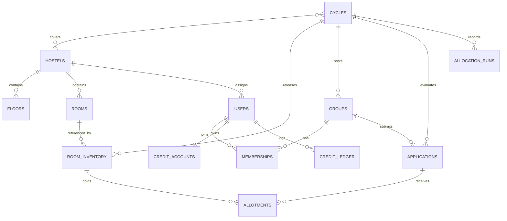
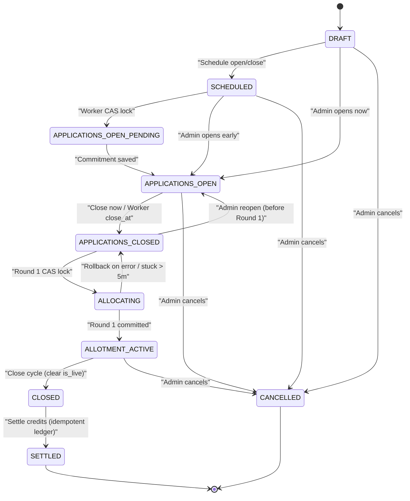
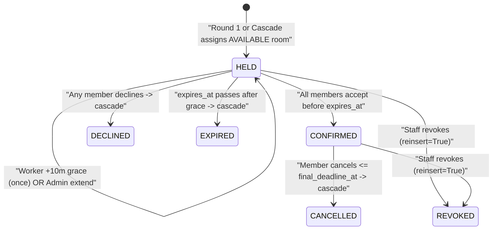

# Data Model, State Machines & Invariants

FairNest persists state in MongoDB 7/8 configured as single-node replica set `rs0`. Data integrity combines **explicit enumerations**, **MongoDB `$jsonSchema` validation**, **compound & partial unique indexes**, **TTL cleanup indexes**, and **runtime invariant verification**.

---

## 1. Collection Inventory (20 Collections)

19 operational collections have automated index creation in [`db/indexes.py`](../backend/app/db/indexes.py), and 1 append-only collection (`allocation_runs`) stores immutable allocation snapshots and hashes.

| Collection | Purpose | Key Document Fields | Retention / Uniqueness |
|---|---|---|---|
| `users` | Accounts, roles, lockout, `token_version` | `_id`, `email`, `roll_no`, `name`, `role`, `hostel_ids`, `managed_hostel_ids`, `status`, `password_hash`, `accessibility_verified`, `token_version`, `failed_logins`, `locked_until`, `activation_token_hash` | Unique `email`; unique `roll_no` (when string); sparse `activation_token_hash` |
| `refresh_tokens` | Hashed refresh tokens & reuse families | `_id`, `user_id`, `token_hash`, `family_id`, `replaced_by`, `revoked`, `expires_at` | Unique `token_hash`; TTL auto-delete at `expires_at` (`0s`) |
| `role_grants` | Elevated staff role audit & active locks | `_id`, `email`, `role`, `hostel_ids`, `status` (`PENDING`/`ACTIVE`/`REVOKED`), `granted_by`, `applied_user_id` | Max 1 `PENDING`/`ACTIVE` grant per `(email, role)` |
| `credit_accounts` | Current `[0, 10]` fairness balance | `user_id`, `credits`, `version`, `updated_at` | Unique `user_id` |
| `credit_ledger` | Immutable history of every credit delta | `_id`, `user_id`, `cycle_id`, `event_type`, `delta`, `credits_before`, `credits_after`, `ref_id`, `reason`, `created_at` | Unique per `(cycle_id, user_id, event_type)` across all 5 `SETTLEMENT_*` types |
| `hostels` | Campus hostel definitions | `_id`, `code`, `name`, `allowed_gender`, `allowed_years`, `active` | Unique `code` |
| `floors` | Floor metadata within a hostel | `_id`, `hostel_id`, `floor_no`, `label`, `active` | Unique `(hostel_id, floor_no)` |
| `rooms` | Physical room catalogue | `_id`, `hostel_id`, `floor_id`, `floor_no`, `room_no`, `capacity`, `features`, `status` (`ACTIVE`/`MAINTENANCE`) | Unique `(hostel_id, room_no)` |
| `cycles` | Allotment cycle config, policy, commit–reveal seed | `_id`, `name`, `academic_year`, `hostel_id`, `status`, `freeze_hours`, `apply_open_at`, `apply_close_at`, `final_deadline_at`, `policy`, `room_ids`, `seed_commitment`, `seed_secret` | Indexed by `(status, apply_open_at)` & `(status, apply_close_at)` |
| `room_inventory` | Per-cycle release state of a physical room | `_id`, `cycle_id`, `room_id`, `hostel_id`, `floor_no`, `capacity`, `status`, `is_live`, `allotment_id`, `version` | Unique `(cycle_id, room_id)`; **Unique `room_id` where `is_live: true`** + `$jsonSchema` |
| `groups` | Student roommate groups & invite lock state | `_id`, `cycle_id`, `leader_id`, `name`, `status`, `solo`, `size`, `gender` | Max 1 active group (`FORMING`/`READY`/`SUBMITTED`/`LOCKED`) per `(cycle_id, leader_id)` |
| `memberships` | Group membership & invites | `_id`, `cycle_id`, `group_id`, `user_id`, `status` (`INVITED`/`ACCEPTED`/`DECLINED`/`LEFT`/`REMOVED`), `role` | Max 1 `ACCEPTED` membership per `(cycle_id, user_id)` |
| `applications` | Submitted preferences, snapshot weights, outcome | `_id`, `cycle_id`, `group_id`, `member_ids`, `status`, `tier`, `group_size`, `ranked_choices`, `fallback`, `weight`, `order_index`, `reinsert`, `last_allotment_status`, `version` | Unique `(cycle_id, group_id)` |
| `allotments` | Active/historical room holds & consent records | `_id`, `cycle_id`, `application_id`, `group_id`, `room_id`, `rank_obtained`, `order_index`, `round_no`, `status`, `is_active`, `members` (`[{user_id, accept_status, accepted_at}]`), `expires_at`, `grace_used`, `admin_extended` | **Unique `(cycle_id, application_id)` & `(cycle_id, room_id)` where `is_active: true`** |
| `allocation_runs` | Audit snapshot of Round-1 & Cascade executions | `_id`, `cycle_id`, `round_no`, `type` (`MAIN`/`CASCADE`), `seed_commitment`, `seed_revealed`, `input_hash`, `output_hash`, `snapshot_room_ids`, `stats`, `created_at` | Queried by `cycle_id` & `type` (invariant: ≤ 1 `MAIN` per cycle) |
| `notifications` | User in-app notification inbox | `_id`, `user_id`, `type`, `title`, `body`, `read`, `created_at` | TTL expire after **90 days** (`7,776,000s`) |
| `outbox` | Async outbound queue (`EMAIL` password resets) | `_id`, `channel`, `to`, `payload`, `status`, `next_attempt_at` | Indexed `(status, next_attempt_at)` |
| `audit_logs` | Append-only governance & security log | `_id`, `actor_id`, `role`, `action`, `target_type`, `target_id`, `before`, `after`, `request_id`, `ip`, `ts` | Indexed by `ts`, `(actor_id, ts)`, `(target_type, target_id)` |
| `idempotency_keys` | Cached responses for safe client retries | `_id`, `user_id`, `key`, `request_hash`, `status_code`, `response`, `expires_at` | Unique `(user_id, key)`; TTL auto-delete at `expires_at` (`0s`) |
| `job_locks` | Distributed lock schema/index reservation | `_id`, `job_name`, `expires_at` | Unique `job_name`; TTL auto-delete at `expires_at` (`0s`) |

> [!NOTE]
> `outbox` and `job_locks` have indexes created in [`db/indexes.py`](../backend/app/db/indexes.py), while the current single-container worker polls directly with atomic MongoDB conditional `update_many`/`find_one_and_update` CAS transitions.

---

## 2. Core Entity Relationships

---

## 3. Lifecycle State Machines

### Cycle State Machine

[`core/constants.py`](../backend/app/core/constants.py) defines the core cycle states, while [`cycle_service.py`](../backend/app/services/cycle_service.py) enforces `_VALID_TRANSITIONS` (including transitional `APPLICATIONS_OPEN_PENDING` used by the worker and alias `OPEN`):

### Allotment & Room Inventory State Machine

Corresponding `room_inventory.status` transitions:
- `AVAILABLE → HELD` (`hold_room`)
- `HELD → CONFIRMED` (`confirm_room`)
- `HELD / CONFIRMED → AVAILABLE` on `DECLINED`, `EXPIRED`, `CANCELLED`, or `REVOKED` (`release_room`, queuing room for next cascade; staff can set room `MAINTENANCE`→`BLOCKED` afterwards)

### Group & Application State Alignment

- **Group (`GroupStatus`):** `FORMING` → `READY` → `SUBMITTED` → `LOCKED` (at close-window), or `WITHDRAWN` / `DISBANDED`.
- **Application (`ApplicationStatus`):** `DRAFT` (editable with `PUT /groups/{id}/application` + `If-Match`) → `SUBMITTED` (locked at window close) → `ALLOTTED` / `WAITLISTED` → `CONFIRMED` / `FORFEITED` (after `DECLINED`/`EXPIRED`/`CANCELLED`) / `WITHDRAWN` / `UNALLOTTED`.

---

## 4. Database `$jsonSchema` Validator & Index Catalog

### MongoDB `$jsonSchema` Validator ([`db/validators.py`](../backend/app/db/validators.py))

MongoDB enforces schema validation directly on `room_inventory` (`validationLevel="moderate"`, `validationAction="error"`):
- Required fields: `cycle_id`, `room_id`, `capacity`, `status`.
- `capacity`: `int` or `long`, bounded `1..8`.
- `status`: enum `["AVAILABLE", "HELD", "CONFIRMED", "BLOCKED"]`.

### Critical Partial Unique & TTL Indexes ([`db/indexes.py`](../backend/app/db/indexes.py))

| Index Name | Collection | Keys & Partial / TTL Constraint | What It Prevents |
|---|---|---|---|
| `inv_live_room_unique` | `room_inventory` | `{room_id: 1}`, `unique=True`, `partialFilterExpression={"is_live": True}` | Physical room released across two live cycles simultaneously |
| `inv_cycle_room_unique` | `room_inventory` | `{cycle_id: 1, room_id: 1}`, `unique=True` | Duplicate room inventory rows in the same cycle |
| `allotments_active_room_unique` | `allotments` | `{cycle_id: 1, room_id: 1}`, `unique=True`, `partialFilterExpression={"is_active": True}` | Double booking two groups into the same room |
| `allotments_active_app_unique` | `allotments` | `{cycle_id: 1, application_id: 1}`, `unique=True`, `partialFilterExpression={"is_active": True}` | Giving one application two active rooms concurrently |
| `memberships_active_unique` | `memberships` | `{cycle_id: 1, user_id: 1}`, `unique=True`, `partialFilterExpression={"status": "ACCEPTED"}` | One student belonging to two groups in the same cycle |
| `groups_cycle_leader_unique` | `groups` | `{cycle_id: 1, leader_id: 1}`, `unique=True`, partial `FORMING/READY/SUBMITTED/LOCKED` | One user leading multiple active groups per cycle |
| `cl_settlement_unique` | `credit_ledger` | `{cycle_id: 1, user_id: 1, event_type: 1}`, `unique=True`, partial across all 5 `SETTLEMENT_*` event types | Double-settling credits on retry or worker race |
| `role_grants_active_unique` | `role_grants` | `{email: 1, role: 1}`, `unique=True`, partial `PENDING/ACTIVE` | Conflicting simultaneous role grants |
| `users_roll_no_unique` | `users` | `{roll_no: 1}`, `unique=True`, `partialFilterExpression={"roll_no": {"$type": "string"}}` | Duplicate student roll numbers while allowing `null` on staff |
| `rt_ttl` | `refresh_tokens` | `{expires_at: 1}`, `expireAfterSeconds=0` | Stale refresh token bloat |
| `idempotency_ttl` | `idempotency_keys` | `{expires_at: 1}`, `expireAfterSeconds=0` | Auto-expires idempotency records after 24 hours |
| `notifications_ttl` | `notifications` | `{created_at: 1}`, `expireAfterSeconds=7776000` | Retains notifications for 90 days |

---

## 5. System Invariants (Verified at Runtime & CLI)

Six core invariants are verified on demand by [`scripts/check_invariants.py`](../backend/scripts/check_invariants.py) (alongside room/allotment alignment checks every 10 minutes inside `worker.run_invariant_check`):

1. **Single Active Occupancy & Capacity Respect:** No `(cycle_id, room_id)` has more than 1 active (`HELD`/`CONFIRMED`) allotment, and the member count never exceeds room `capacity`.
2. **Single Live Cycle per Room:** No `room_id` appears in more than 1 `room_inventory` document with `is_live: true`.
3. **Single Round-1 Execution per Cycle:** No `cycle_id` has more than 1 `type: "MAIN"` record in `allocation_runs`.
4. **Bounded Fairness Credits:** Every `credit_accounts.credits` value satisfies `C_MIN <= credits <= C_MAX` (`[0, 10]`).
5. **Unanimous Confirmation Integrity:** Every `CONFIRMED` allotment has `accept_status == "ACCEPTED"` for **100%** of its `members` array.
6. **Single Active Group per Student:** No `(cycle_id, user_id)` has more than 1 membership with `status == "ACCEPTED"`.

---

**Related:** [System Architecture](architecture.md) · [ADR-0001: MongoDB Replica Set & Transactions](adr/0001-mongo-transactions.md) · [Operations & Runbook](operations-testing-and-runbook.md)
