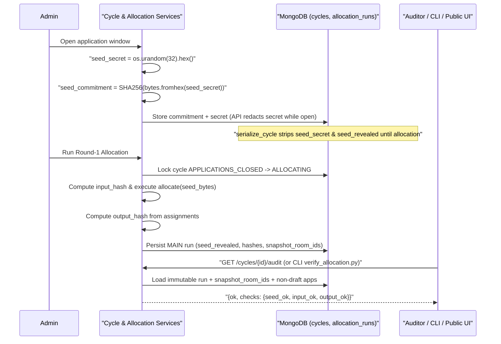

# Unique Design Aspects & Core Algorithms

FairNest is intentionally engineered around **fairness-by-construction, cryptographic auditability, and zero-payment unanimous consent** rather than ad-hoc First-Come-First-Served (FCFS) races or pure blind lotteries. This document details every distinct design innovation and its exact algorithmic implementation in the codebase.

---

## Summary of Unique Innovations

| # | Innovation | Why It Matters | Primary Implementation |
|---|---|---|---|
| 1 | **Zero-Payment Unanimous Group Consent** | Eliminates payment-gateway failure states and prevents one roommate from silently committing unwilling members | [`allotment_service.py`](../backend/app/services/allotment_service.py), [`core_repos.py`](../backend/app/repositories/core_repos.py) |
| 2 | **Efraimidis–Spirakis Weighted RSD** | Strategy-proof lottery weighting where preference rank cannot be gamed to boost priority | [`allocate()`](../backend/app/allocator/core.py#L278-L313) |
| 3 | **Bounded Inter-Cycle Fairness Credits (`[0, 10]`)** | Self-correcting cross-cycle equity without "rich-get-richer" hoarding or permanent starvation | [`fairness/engine.py`](../backend/app/fairness/engine.py), [`allocator/core.py`](../backend/app/allocator/core.py) |
| 4 | **Tier-0 Accessibility Isolation** | Verified accessibility needs (`tier = 0`) are satisfied strictly ahead of general lottery (`tier = 1`) | [`allocation_service.py`](../backend/app/services/allocation_service.py), [`cycle_service.py`](../backend/app/services/cycle_service.py) |
| 5 | **No-Re-Randomization Cascade + Revoke Rescue** | Declined/expired rooms flow deterministically to the next Round-1 waitlist position; admin revokes rescue affected groups to queue front | [`assign_in_order()`](../backend/app/allocator/core.py#L259-L275) |
| 6 | **Cryptographic Commit–Reveal Verification** | Publishes `SHA-256(seed)` at cycle open and proves exact Round-1 reproducibility via canonical input/output SHA-256 hashes | [`allocation_service.py`](../backend/app/services/allocation_service.py), [`allocator/verify.py`](../backend/app/allocator/verify.py) |
| 7 | **Single-Live-Release Room Lock** | Enforces at DB level (`inv_live_room_unique`) that no physical room can be live across two overlapping cycles | [`indexes.py`](../backend/app/db/indexes.py), [`catalogue_service.py`](../backend/app/services/catalogue_service.py) |
| 8 | **Automatic One-Time Grace Extension** | Automatically grants a single `+10m` window extension when a `HELD` allotment approaches expiry with partial acceptances | [`worker.py`](../backend/app/worker.py), [`core_repos.py`](../backend/app/repositories/core_repos.py) |
| 9 | **Natural Room Sorting & Spare-Capacity Fallback** | Understands numeric room labels (`"21" < "201"`, `"A-2" < "A-10"`) and minimizes wasted beds on fallback | [`_room_sort_key`](../backend/app/allocator/core.py#L137-L140), [`_pick_fallback_room`](../backend/app/allocator/core.py#L171-L208) |
| 10 | **Comma-List Room Parser & Dry-Run Diff** | Bulk room provisioning with `:capacity` overrides (`"101:2, 102"`) and duplicate/conflict classification before DB writes | [`catalogue_service.py`](../backend/app/services/catalogue_service.py), [`RoomListInput.jsx`](../frontend/src/components/rooms/RoomListInput.jsx) |
| 11 | **Personalized Student Fairness Diagnostics** | Explains each student's exact draw position, why skipped ranks lost (`taken earlier`, `blocked`, `not reached`), and expected credit shift | [`get_my_fairness`](../backend/app/api/routes/auth.py#L178-L335) |
| 12 | **Dual-Mode IDOR Concealment vs. Audited Staff Scope** | Masks cross-hostel unauthorized probes from students as `404`, while enforcing `403 HOSTEL_SCOPE_DENIED` on staff | [`scope.py`](../backend/app/core/scope.py) |

---

## 1. Zero-Payment Unanimous Group Consent Model

In traditional booking systems, a hold expires unless payment clears. FairNest removes payment completely and replaces it with **shared consent accountability**:

1. Every Round-1 or cascade match creates an allotment in `HELD` status with `expires_at = now + cycle.freeze_hours`, populating `members` with `{user_id, accept_status: "PENDING", accepted_at: null}` for every accepted group member.
2. Each member independently invokes `POST /allotments/{id}/accept` (`accept_member` in [`core_repos.py`](../backend/app/repositories/core_repos.py)).
3. An atomic `find_one_and_update` checks `status == "HELD"`, `expires_at > now`, and `members` `$elemMatch` matching `user_id` with `accept_status == "PENDING"`.
4. Only when **all** `members` reach `accept_status == "ACCEPTED"` does the transaction promote the allotment from `HELD` to `CONFIRMED` and update `room_inventory` (`HELD` → `CONFIRMED`) plus group/application statuses.
5. If **any single member declines** (`POST /allotments/{id}/decline`) or lets `expires_at` pass, the **entire group's** allotment becomes `DECLINED` or `EXPIRED` (`is_active: false`), `room_inventory` returns to `AVAILABLE`, and the application is marked `FORFEITED` (`forfeit_delta = -2` for every member at cycle settlement).

> [!NOTE]
> Once confirmed (`CONFIRMED`), members can still self-cancel **before the cycle's `final_deadline_at` and before cycle close** via `POST /allotments/{id}/cancel` (`CANCELLED`, releasing the room to cascade and mapping to `late_cancel_delta = -1` during `settle_cycle`). Once `final_deadline_at` passes, self-cancellation raises `409 CANCEL_CUTOFF_PASSED`.

---

## 2. Efraimidis–Spirakis Weighted Random Serial Dictatorship (RSD)

Rather than shuffling uniformly or letting fast clickers dominate, Round-1 allocation uses **Weighted Random Serial Dictatorship** implemented with the **Efraimidis–Spirakis weighted reservoir key** over cryptographic HMAC-SHA256 pseudorandomness ([`allocate()`](../backend/app/allocator/core.py#L278-L313)).

### Mathematical Formulation

For each submitted application $a$ with group lottery weight $w_a \ge 1.0$, secret byte string $S$, and application identifier $\text{id}_a$:

1. **Deterministic Cryptographic Uniform Draw $u_a \in (0, 1)$:**
   $$\text{MAC}_a = \text{HMAC-SHA256}(S,\ \text{UTF-8}(\text{id}_a))$$
   $$\text{val}_a = \text{uint64}_{\text{BE}}(\text{MAC}_a[0..7])$$
   $$u_a = \frac{\text{val}_a + 1}{2^{64} + 1}$$
   Using $+1$ and $2^{64}+1$ strictly bounds $u_a \in (0, 1)$, guaranteeing $\ln(u_a)$ is always finite and negative without edge-case division/domain errors.

2. **Exponential Race Key $k_a$:**
   $$k_a = \frac{\ln(u_a)}{\max(w_a,\ 10^{-9})}$$
   Because $u_a \sim \text{Uniform}(0, 1)$, $-\ln(u_a) \sim \text{Exp}(1)$, hence $-k_a = \frac{-\ln(u_a)}{w_a} \sim \text{Exp}(w_a)$ is the arrival time of an exponential race with rate $w_a$. Sorting by ascending $-k_a$ (equivalently descending $k_a$) yields the exact weighted sampling-without-replacement order: at every step, candidate $i$ is drawn next with probability proportional to $w_i$ among remaining candidates.

3. **Canonical Deterministic Sort Tuple:**
   ```python
   (not a.reinsert, a.tier, -key, a.id)
   ```
   - `not a.reinsert`: `False < True`, so revoked/reinserted groups (`reinsert=True`) are ordered **first**.
   - `a.tier`: `0` (verified accessibility) precedes `1` (general).
   - `-key`: smaller exponential race arrival time (higher credit weight in expectation) precedes larger.
   - `a.id`: lexical UTF-8 string tiebreaker guarantees total determinism across platforms.

4. **Serial Room Assignment:**
   Walking `ordered_apps` once, each application inspects `choices[0..n-1]` in preference order (`ROOM` or `FLOOR`), optionally falls back via `ANY_ELIGIBLE`, and claims the first available fitting room.

### Why Weighted RSD Is Strategy-Proof

`ordered_apps` is determined **solely** by `(reinsert, tier, seed, app_id, weight)`—**the contents of `choices` are never read during ordering**. Misreporting preferences cannot move an application earlier in the queue, and once its turn arrives, the algorithm strictly picks the **highest-ranked available room** from its preference list. Truthful ranking is therefore a weakly dominant strategy within any single cycle.

---

## 3. Group Weighting & Bounded Inter-Cycle Fairness Credits (`[0, 10]`)

While single-shot weighted RSD guarantees intra-cycle truthfulness, FairNest connects multiple cycles across semesters using **bounded fairness credits** ([`fairness/engine.py`](../backend/app/fairness/engine.py)).

### Credit Parameters (`DEFAULT_POLICY`)

| Parameter | Default | Role |
|---|---|---|
| `c_init` | `3` | Starting credit balance for newly activated students and baseline for carry-over damping |
| `c_min` / `c_max` | `0` / `10` | Hard invariant bounds enforced atomically on credit updates |
| `member_weight(c)` | `1.0 + c` | Maps `c in [0, 10]` to weight in `[1.0, 11.0]` (never zero, preventing division by zero or total exclusion) |
| `group_weight_policy` | `"MEAN"` | `"MEAN"` (default), `"MIN"`, or `"MAX"` over member weights (`compute_weight` / `group_weight`) |
| `rank_deltas` | `1:-3, 2:-2, 3:-1, 4:0, 5:0, default:+1` | Credit adjustment on `CONFIRMED` allotment; fallback (`rank > len(choices)`) uses `"default": +1` |
| `unallotted_delta` | `+2` | Reward granted to students who remain `UNALLOTTED` at settlement |
| `forfeit_delta` | `-2` | Penalty applied to every group member after declining or letting a hold expire |
| `late_cancel_delta` | `-1` | Penalty applied after cancelling post `cancel_cutoff_at` |
| `REVOKED` | `0` | Zero penalty when an admin/warden revokes an allotment (`SETTLEMENT_REVOKED`) |
| `carry_over_factor` | `0.5` | Inter-cycle exponential damping toward `c_init` |

### Carry-Over Damping & Clamping

Between simulated sequential cycles in the offline evaluator ([`simulator/engine.py`](../simulator/simulator/engine.py)), [`apply_carry_over`](../backend/app/allocator/core.py#L359-L364) gently pulls extreme historical scores back toward equilibrium:

$$\text{credits}_{\text{next}} = \text{clamp}_{[c_{\min},\, c_{\max}]}\!\left(c_{\text{init}} + \text{round}\!\left((\text{credits} - c_{\text{init}}) \times 0.5\right)\right)$$

For example, a student finishing at `10` carries into the next cycle at `3 + round(7 * 0.5) = 7`, while a student finishing at `0` recovers to `3 + round(-3 * 0.5) = 1` (Python `round(-1.5) == -2`, `3 - 2 = 1`). In the live backend service, [`settle_cycle`](../backend/app/services/allotment_service.py) applies outcome deltas atomically inside `credit_accounts` with `$max`/`$min` clamping and idempotent `credit_ledger` entries (`cl_settlement_unique`).

---

## 4. Tier-0 Accessibility Isolation

During application window closing (`close_window_impl` / `_compute_snapshot_and_tier`), the backend resolves every accepted member's user record:
- If **at least one** accepted group member has `accessibility_verified == True`, the application is tagged `tier = 0`; otherwise `tier = 1`.
- Because `tier` precedes `-key` in the sort tuple `(not a.reinsert, a.tier, -key, a.id)`, Tier-0 applications are guaranteed to be served **strictly ahead** of Tier-1 applications, regardless of credit weights.
- **Admins/Wardens verify or revoke accessibility status** via `PUT /warden/users/{user_id}/accessibility` (emitting `VERIFY_ACCESSIBILITY` audit logs with optional review notes).

---

## 5. No-Re-Randomization Cascade & Revoke Rescue

When an allotment is declined, cancelled, or expires, **FairNest never re-runs the lottery**. Re-randomizing mid-cycle would let unallotted groups gamble on cascades and violate Round-1 priority promises.

Instead:
1. `_load_snapshot(..., waitlisted_only=True)` fetches all `WAITLISTED` applications, preserving their immutable Round-1 `order_index`.
2. [`assign_in_order()`](../backend/app/allocator/core.py#L259-L275) sorts waitlisted applications solely by:
   ```python
   (not a.reinsert, a.order_index if a.order_index is not None else 10**9, a.id)
   ```
   Notice `_hmac_uniform` is **never called** during cascades.
3. Newly available rooms (`AVAILABLE`) flow strictly in deterministic Round-1 order (with one exception: `reinsert=True` groups go first).
4. **Revoke Rescue (`revoke_allotment`):** If an admin/warden must reclaim an already `HELD` or `CONFIRMED` room (e.g., structural damage or maintenance emergency), the room moves to `BLOCKED`, any active allotment becomes `REVOKED`, and the affected application is returned to `WAITLISTED` with **`reinsert = True`** and `last_allotment_status = "REVOKED"` (`0` credit penalty). On the very next cascade, `(not True) == False` places that displaced group at the front of the queue.

---

## 6. Cryptographic Commit–Reveal Verification

To eliminate any suspicion that administrators picked a favorable seed after inspecting student preferences, FairNest implements a three-phase **Commit–Reveal Protocol**:



### Canonical Verification Mechanics

In [`allocation_service.py`](../backend/app/services/allocation_service.py), both allocation and audit recompute hashes identically:
- **Seed Commitment Check:** `SHA-256(bytes.fromhex(seed_revealed)).hexdigest() == seed_commitment`.
- **Canonical Input Hash (`_compute_input_hash`):** JSON object `{"apps": ..., "free_rooms": sorted(...), "seed": seed.hex()}` with `apps` sorted by `"id"`, serialized via `json.dumps(data, sort_keys=True)`.
- **Canonical Output Hash (`_compute_output_hash`):** JSON array of `{"app_id", "order_index", "rank", "room_id"}` sorted by `"app_id"`, using `json.dumps(data, sort_keys=True)`.
- **Snapshot Preservation:** `run_allocation` writes `snapshot_room_ids` onto the `MAIN` `allocation_runs` record, and `verify_allocation` loads applications with status in `("SUBMITTED", "ALLOTTED", "WAITLISTED", "CONFIRMED", "FORFEITED", "UNALLOTTED")` via `_load_snapshot(..., for_verification=True)` so verification **remains valid even after confirms, forfeits, cascades, and settlement**.

> [!NOTE]
> Look closely at the UTF-8 vs. hex contract if reusing helpers directly: `allocation_service.py` hashes raw random bytes (`bytes.fromhex(seed_hex)`), whereas the standalone pure verification helper module [`allocator/verify.py`](../backend/app/allocator/verify.py) takes UTF-8 strings (`seed.encode("utf-8")`) matching `run_allocation_pure()` in unit tests.

---

## 7. Single-Live-Release Room Lock

Multiple hostel cycles can exist concurrently (e.g., Hostel A Fall cycle and Hostel B Fall cycle, or a future `DRAFT`/`SCHEDULED` cycle alongside an active cycle). To guarantee two live cycles can **never** allocate the same physical room:

- Every `room_inventory` document carries `is_live: bool`.
- MongoDB enforces a **partial unique index** `inv_live_room_unique` on `{room_id: 1}` restricted to `{is_live: true}` ([`indexes.py`](../backend/app/db/indexes.py)).
- Opening a cycle ([`open_cycle_impl`](../backend/app/services/cycle_service.py#L69-L192)) snapshots eligible `ACTIVE` rooms with `is_live: True` inside a transaction and raises **`409 ROOM_IN_LIVE_RELEASE`** if any target room already holds `is_live: True` in another cycle.
- Releasing the lock sets `is_live: False` cleanly when the cycle closes (`worker.run_close_cycle_check`), settles (`settle_cycle`), or cancels (`cancel_cycle`).

---

## 8. Automatic One-Time `+10m` Worker Grace Extension

Strict group hold expiry can unfairly punish groups where members are close to confirming:

- Every 30 seconds, the worker's [`run_expire_holds`](../backend/app/worker.py#L23-L79) scans `HELD` allotments where `expires_at <= now` and invokes [`try_extend_grace`](../backend/app/repositories/core_repos.py#L230-L245).
- Eligibility condition inside MongoDB `update_one`:
  - `status == "HELD"`
  - `grace_used == False`
  - `members` matches `$elemMatch: {"accept_status": "PENDING"}`
- Eligible holds receive a single automatic `+10 minutes` extension (`expires_at += 10m`, `grace_used = True`), giving remaining members one final window before the next sweeper pass moves unresolved holds to `EXPIRED`.
- This is strictly distinct from **manual admin hold extension** (`POST /admin/allotments/{id}/extend`), which adds 1–72 hours (`admin_extended: True`, requiring a ≥ 10-character reason).

---

## 9. Natural Room Sorting, Fit Rules & Spare-Capacity Fallback

Three deterministic rules in [`allocator/core.py`](../backend/app/allocator/core.py) eliminate lexicographic surprises and wasted hostel capacity:

1. **Natural Numeric Sorting (`_room_sort_key`):** Splits room numbers on `\d+` chunks (`"21"` sorts before `"201"`, `"A-2"` before `"A-10"`, case-insensitive).
2. **`FILL_RULE` Enforcement (`_fits`):**
   - `EXACT` (default): `room.capacity == group_size`
   - `AT_MOST`: `group_size <= room.capacity`
3. **`FLOOR` Choice & `ANY_ELIGIBLE` Fallback (`_resolve_choice`, `_pick_fallback_room`):**
   - Choosing a `FLOOR` picks the **lowest natural-sorted free fitting room** on `(hostel_id, floor_no)`.
   - `ANY_ELIGIBLE` infers eligible hostels from the group's ranked choices (or allows any hostel if zero choices were provided) and sorts all fitting free rooms by:
     ```python
     (room.capacity - app.group_size, room.hostel_id, room.floor_no, _room_sort_key(room.room_no), room_id)
     ```
     Prioritizing `room.capacity - app.group_size` minimizes spare empty beds whenever `AT_MOST` fill rule is active.

---

## 10. Bulk Comma-List Room Parser with Dry-Run Diff

Wardens and admins frequently add entire hostel corridors at once. [`parse_room_entries`](../backend/app/services/catalogue_service.py) (backing `POST /admin/floors/{floor_id}/rooms/from-list` and rendered interactively in [`RoomListInput.jsx`](../frontend/src/components/rooms/RoomListInput.jsx)) supports:
- Comma and/or newline-delimited tokens (e.g., `"101, 102:3, A-104"`), max 200 rooms per batch.
- Inline `:capacity` overrides (validated `1..8`, defaulting to `default_capacity`).
- Strict uppercase regex `^[A-Z0-9\-/]{1,10}$`.
- **Dry-run mode (`?dry_run=true`):** Classifies tokens into `to_create` (new rooms to create), `duplicates_in_input`, `already_exist` (checked against DB), and `invalid` before committing any document.

---

## 11. Personalized Student Fairness Explanation

Transparency reduces student disputes. `GET /me/fairness` ([`auth.py`](../backend/app/api/routes/auth.py#L178-L335)) computes a personal post-allocation breakdown across the most recent active/settled cycles:
- Current `credits`, lottery `weight` (`1 + credits`), and group effective weight (`weight`).
- Round-1 queue position: `order_index` among `total_applicants`.
- Choice-by-choice audit trail: labels each ranked preference (`ROOM` or `FLOOR`) as `MATCHED` or `SKIPPED` with exact human-readable cause (`"Allotted at this preference"`, `"Taken by a higher-ordered application"`, `"Room blocked / unavailable at allocation time"`, `"Not reached or unavailable"`).
- Expected credit delta and outcome event type.

---

## 12. Dual-Mode Hostel Scope Enforcement & Privacy Masking

Rather than uniform `403 Forbidden` responses that confirm the existence of other students' groups or rooms in another hostel, [`core/scope.py`](../backend/app/core/scope.py) adapts behavior by actor role:
- **Students (`assert_student_scope`, `assert_student_eligible_for_hostel`):** Any cross-hostel room, cycle, or group access raises **`404 NotFoundError`** (IDOR resource existence masking).
- **Staff (`assert_staff_scope` for `ADMIN` / `WARDEN` / scoped `AUDITOR`):** Cross-hostel management raises **`403 ForbiddenError(code="HOSTEL_SCOPE_DENIED")`**, paired with `audit_scope_violation` helpers writing immutable `SCOPE_DENIED:*` records in `audit_logs`. `SUPER_ADMIN` and global `AUDITOR` (empty `managed_hostel_ids`) have campus-wide visibility.

---

**Related:** [System Architecture](architecture.md) · [ADR-0003: Commit–Reveal](adr/0003-commit-reveal.md) · [ADR-0004: Weighted RSD & Credits](adr/0004-weighted-rsd-and-bounded-credits.md) · [ADR-0005: Zero-Payment Consent](adr/0005-zero-payment-group-consent-model.md)
