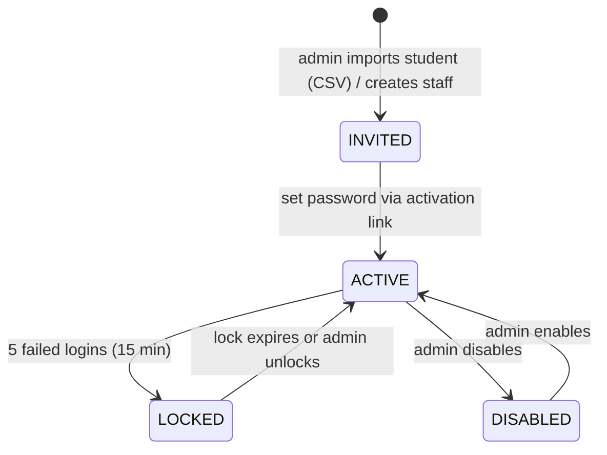
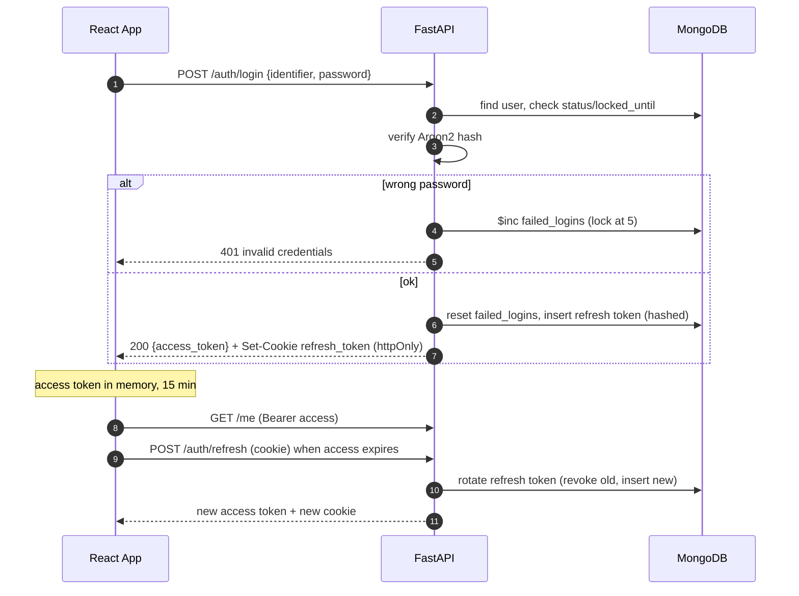
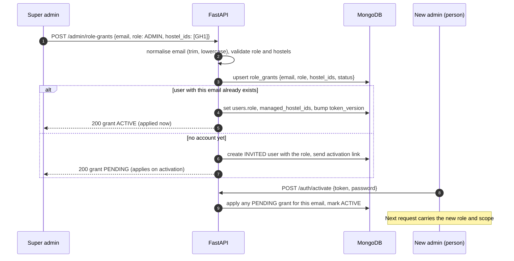
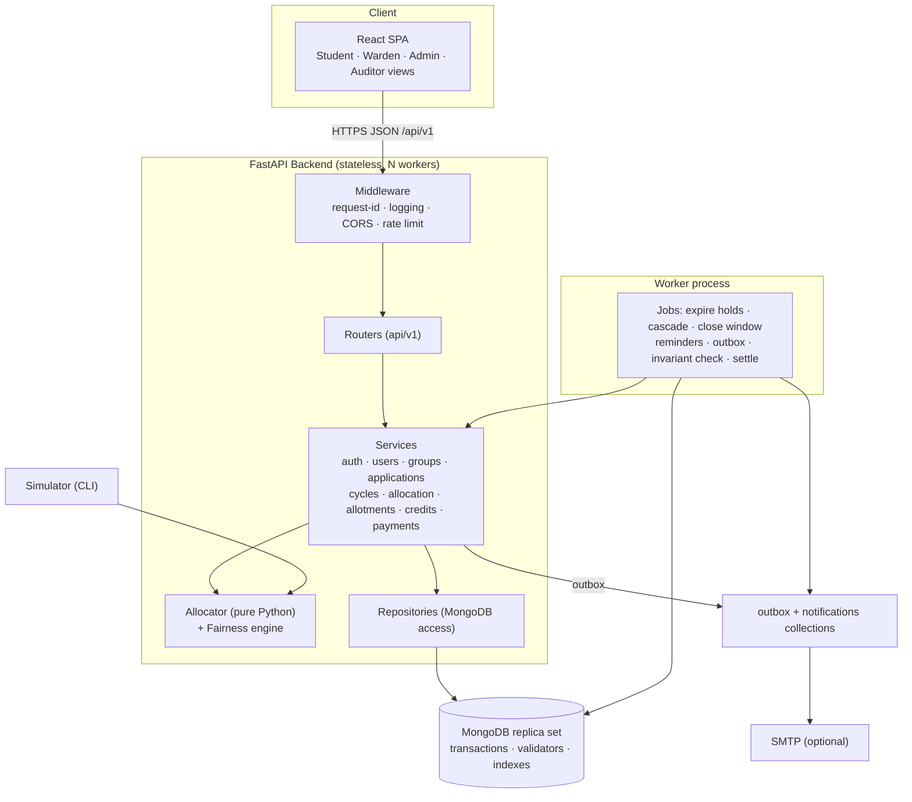
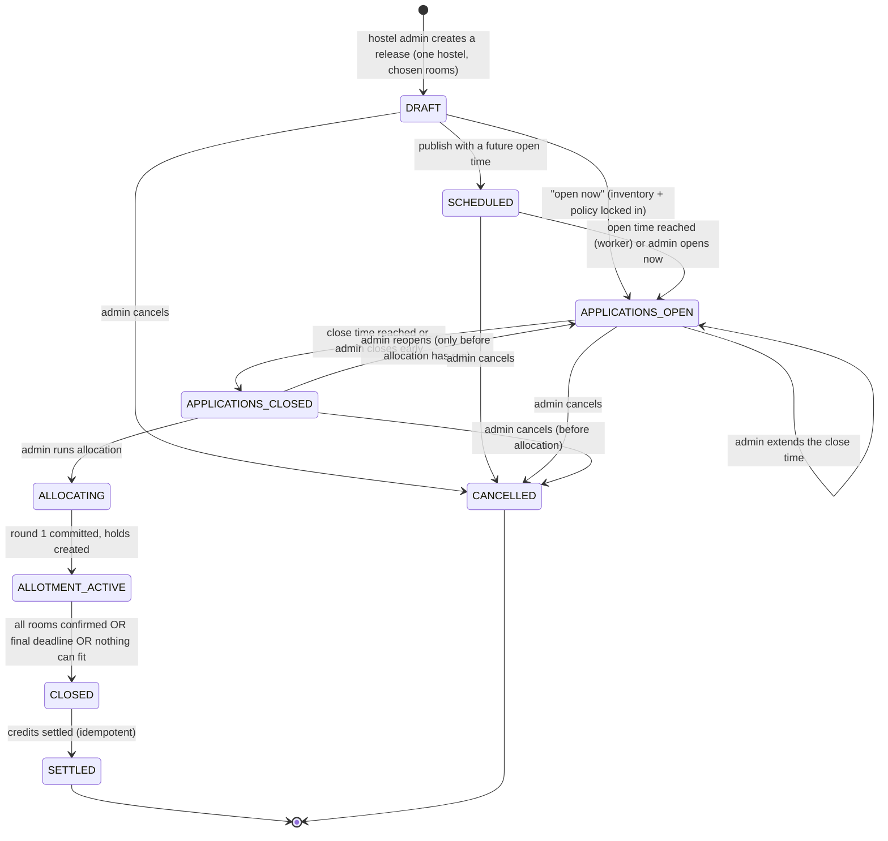
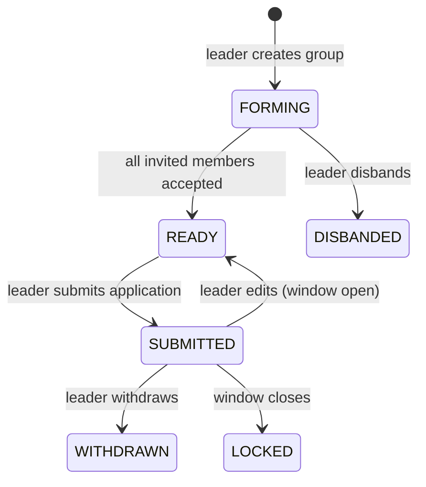
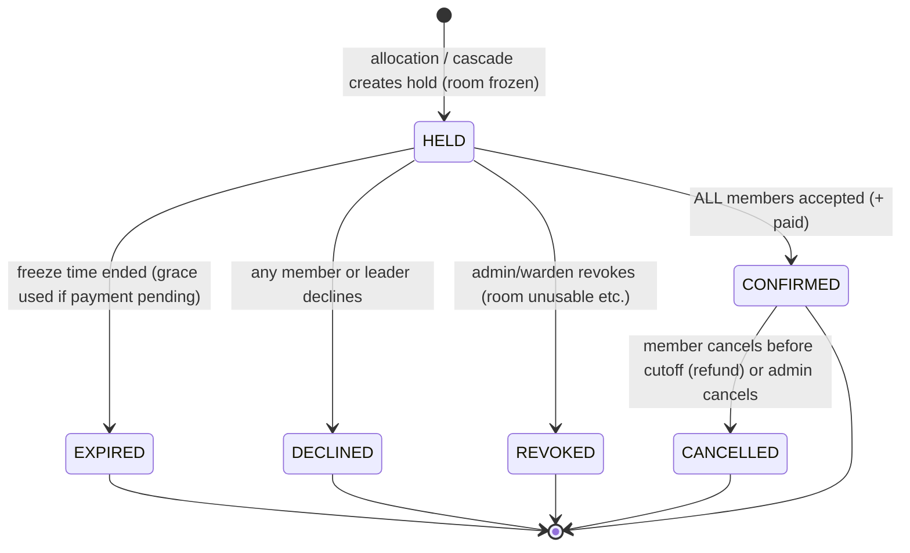
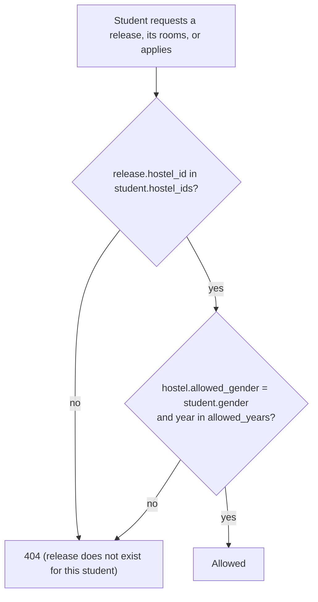

# Hostel Allotment System: Detailed Technical Implementation Plan

**Project:** Fairness-Based Hostel Allotment with Group Preferences and a Credit System
**Course:** Computer System Design (Booking Systems theme)
**Stack:** React (JavaScript) · Python FastAPI · MongoDB
**Deliverables:** (1) working web application, (2) simulator that compares allocation policies, (3) tests, performance numbers, and an analysis of advantages and limitations.

> **Revision 2 (what changed):** this version adds four things, each folded into the sections shown.
>
> | # | Requirement | Where it lives |
> |---|---|---|
> | 1 | **Admin roles are granted by email.** A super admin types an email and a role (and which hostels). It takes effect as soon as that person has an account, even if they have not signed up yet. | §3, §4.4, §8.14 |
> | 2 | **Rooms are entered as a comma-separated list** (`201, 202, 203:3, 204`). The system turns it into individual rooms, with a preview before saving. | §8.0 (R-INV-8), §11.2, §13.1 |
> | 3 | **Releases are fully controlled by the hostel admin.** No fixed day. The admin picks when it opens (now or later) and when it closes, and can extend, close early, reopen or cancel. | §6.1, §8.12, §11.3 |
> | 4 | **Hostel scoping.** Every student carries a hostel ID. A release is tied to one hostel, so a boy never sees or applies to a girls' hostel release (and the reverse). Hostel admins only manage their own hostel. | §3, §8.13, §7.1 |
>
> Scale used throughout: **about 300 students competing for 100 beds**, in rooms of 1 to 4 beds, with solo and group applicants and a few very popular rooms.

> This plan implements the "hostel" slice of the HLD. It reuses the HLD's ideas (hold → confirm, atomic inventory update, idempotency, request window, weighted lottery, credits, commit-reveal seed) and maps them onto **MongoDB** instead of PostgreSQL.

---

## Table of Contents

1. [Scope, Positioning & Glossary](#1-scope-positioning--glossary)
2. [Technology Stack & Key Decisions](#2-technology-stack--key-decisions)
3. [Roles & Permissions (RBAC)](#3-roles--permissions-rbac)
4. [Authentication & Session Design](#4-authentication--session-design)
5. [System Architecture](#5-system-architecture)
6. [Domain Model & State Machines](#6-domain-model--state-machines)
7. [MongoDB Schema, Indexes & Validators](#7-mongodb-schema-indexes--validators)
8. [Business Rules (Complete Rule Book)](#8-business-rules-complete-rule-book)
9. [Fairness & Credit System (Detailed)](#9-fairness--credit-system-detailed)
10. [Core Algorithms & Atomic Operations](#10-core-algorithms--atomic-operations)
11. [API Specification](#11-api-specification)
12. [Directory Structure (Every Feature)](#12-directory-structure-every-feature)
13. [Frontend Plan](#13-frontend-plan)
14. [Background Jobs & Notifications](#14-background-jobs--notifications)
15. [Non-Functional Requirements and How They Are Met](#15-non-functional-requirements-and-how-they-are-met)
16. [Testing Strategy](#16-testing-strategy)
17. [Simulator & Evaluation Plan](#17-simulator--evaluation-plan)
18. [The 8 Phases](#18-the-8-phases)
19. [Risks, Priorities & Definition of Done](#19-risks-priorities--definition-of-done)
20. [Appendix: Config, Docker, Env, References](#20-appendix-config-docker-env-references)

---

## 1. Scope, Positioning & Glossary

### 1.1 Problem

A hostel has a **fixed number of rooms**, organised as **Hostel → Floor (level) → Room**. Rooms are **released by that hostel's admin whenever the admin decides** (there is no fixed yearly date), and each release has its own opening and closing time. Releases are **scoped to one hostel**, and only students who belong to that hostel can see and apply to it. Demand exceeds supply (for example about **300 students for 100 beds**, in rooms of 1 to 4 beds). **The unit of allotment is the room** (a room number on a floor), not a bed. Speed is irrelevant. The real questions are:

1. **Who** gets a room (fairness across students, including repeat losers)?
2. **Which room and which floor** (preferences, and friends who want to stay together in one room)?
3. **What happens if an allotted student does not take the room** (freeze, confirm, release, next person)?

### 1.2 What we build

| Part | Description |
|---|---|
| **Web app** | Students form groups and rank rooms. Admin runs a verifiable weighted allocation. Allotted rooms are **frozen (held)**, then **confirmed** (accept + mock payment) or **released** to the next waiting group. Credits update fairly. |
| **Simulator** | Reuses the *same allocator code* to compare policies (random vs credit-weighted vs group-aware) over many cycles with metrics (Jain's index, preference rank, group vs solo success). |

### 1.3 Positioning against the professor's sub-themes

| Our feature | Closest sub-theme |
|---|---|
| Freeze → confirm/pay → on failure promote next waiting group | Sub-theme 2 (Payment Queue-Based Booking) |
| Credits, history-based priority, fair allocation, metrics | Sub-theme 4 (Fairness-Based Priority) and Sub-theme 6 (user-chance fairness, credit wallet) |
| Simulator with reproducible runs | Sub-theme 5 (simulator; synthetic data only unless real data is gathered) |

### 1.4 Glossary

| Term | Meaning |
|---|---|
| **Cycle / Release** | One allotment event for **one hostel** (for example "Girls Hostel 1, August intake"). In the database it is a `cycles` document with a `hostel_id`. A hostel can run many releases over time. All allotment data is scoped to a cycle. |
| **Release schedule** | The admin-chosen `apply_open_at` and `apply_close_at` of a release. The admin can open now, schedule for later, extend, close early, reopen (before allocation) or cancel. |
| **Hostel ID (`hostel_ids`)** | A tag on each student saying which hostel(s) they belong to. A student only sees and applies to releases of those hostels. |
| **Admin scope (`managed_hostel_ids`)** | The hostels a `WARDEN` or `ADMIN` may manage. `SUPER_ADMIN` is not limited. |
| **Role grant** | A record "this email gets this role (for these hostels)". Applied when the person has an account, immediately if they already do. |
| **Floor (level)** | A level of a hostel (0 = ground). Contains rooms. Students can rank a whole floor ("any room on floor 2") as a preference. |
| **Room** | The **unit of allotment**. Has a room number, a floor, and a `capacity` (how many students it houses: 1 = single, 2 = double, ...). |
| **Fill rule** | `EXACT` (default): group size must equal room capacity. `AT_MOST`: group size ≤ capacity. |
| **Window** | Time range in which applications can be created/edited. Closed windows are locked. |
| **Group** | 1 to 4 students applying together (a solo student is a group of 1). Has one **leader**. |
| **Application** | A group's submitted ranked list of rooms (+ fallback option). One per group per cycle. |
| **Weight** | Lottery weight of an application, derived from credits. |
| **Round** | Round 1 is the main allocation. Later "cascade" rounds re-offer released rooms. |
| **Allotment** | Result linking an application to a room. Starts as **HELD** (frozen). |
| **Freeze / Hold** | Temporary reservation of a room for a group for a fixed time (default 48 h). |
| **Confirm** | Every member accepts (and pays, if enabled). The room becomes permanently assigned. |
| **Release** | A held or confirmed room returned to inventory (expiry, decline, cancel, revoke). |
| **Credits** | Per-student fairness points. Low credits mean lower odds. More credits mean higher odds. |
| **Tier** | Hard priority class (for example accessibility) processed before the weighted lottery. |

---

## 2. Technology Stack & Key Decisions

| Layer | Choice | Notes |
|---|---|---|
| Frontend | **React (JavaScript)** + **Vite** | React Router, TanStack Query (server state), Axios, Material UI (or Tailwind), react-hook-form, `@dnd-kit` (drag-to-rank), Recharts (dashboards) |
| Backend | **Python 3.11+ / FastAPI** (async) | Pydantic v2 models, `uvicorn` (dev) / `gunicorn -k uvicorn.workers.UvicornWorker` (prod) |
| Database | **MongoDB 6+/7+ as a replica set** | Replica set is **required for multi-document transactions** (even a single-node replica set locally) |
| DB driver | **PyMongo Async API (`AsyncMongoClient`)** | Motor is deprecated (May 2025) and reached end of life in May 2026, so do **not** use Motor. `from pymongo import AsyncMongoClient` |
| Auth | JWT access token + rotating opaque refresh token | `PyJWT`, `argon2-cffi` (or `pwdlib`) for password hashing |
| Background work | Separate **worker process** (`python -m app.worker`) | Idempotent jobs, so running two workers is safe |
| Payments | **Mock payment gateway** module | Configurable success/fail/timeout probabilities. Enables sub-theme 2 style experiments |
| Email | SMTP via `aiosmtplib` (optional), plus in-app notifications | Outbox pattern |
| Testing | `pytest`, `pytest-asyncio`, `httpx.AsyncClient`, `hypothesis`, k6 or Locust | Tests run against a **real** Mongo replica set (mongomock cannot do transactions) |
| Quality | `ruff`, `black`, `mypy` (optional), ESLint, Prettier, GitHub Actions CI | |
| Packaging | Docker Compose | `mongo` (replica set), `backend`, `worker`, `frontend` |

### 2.1 Key MongoDB-specific decisions (and why)

| Decision | Reason |
|---|---|
| **One `room_inventory` row per `(cycle_id, room_id)` with a `status`** (`AVAILABLE / HELD / CONFIRMED / BLOCKED`) | Same idea as the HLD's `slot_inventory`, but a room is all-or-nothing, so a single status replaces counters. Atomic compare-and-set (`AVAILABLE → HELD`) is the double-allocation defence. |
| **Atomic conditional `update_one`** (`{status: "AVAILABLE"}` + `$set: {status: "HELD"}`) | Single-document operations in MongoDB are atomic. Two groups can never both take the same room. No race, no retry loop. |
| **Transactions** (`session.with_transaction`) when more than one document must change together (allotment + inventory + application status) | Prevents partial updates, and `with_transaction` retries transient errors automatically. |
| **Allocation computed in memory by a pure function, then committed in one transaction** | Deterministic, unit-testable, reusable by the simulator, and verifiable by re-running with the revealed seed. |
| **`$jsonSchema` validators** on `room_inventory` (status must be one of the allowed values, capacity ≥ 1) | Database-level safety net, like the HLD's `CHECK` constraint. |
| **Unique and partial unique indexes** | One application per group per cycle. One active membership per user per cycle. One active allotment per application **and per room**. |
| **`is_active` boolean + partial unique index** instead of `$in` in index filters | Keeps partial-index filters simple and portable. |
| **Aggregation-pipeline updates** for clamped credits | `credits = min(C_MAX, max(C_MIN, credits + delta))` in a single atomic update. |
| **Write concern `majority`, `tz_aware=True` datetimes (UTC)** | Durability and no timezone bugs. |
| **TTL indexes** for refresh tokens, idempotency keys and notifications | Automatic cleanup with no cron job. |
| **ObjectId internally, strings in the API** | A small `PyObjectId` helper in Pydantic models. |

---

## 3. Roles & Permissions (RBAC)

### 3.1 Roles

| Role | Who | Purpose |
|---|---|---|
| `STUDENT` | Applicants | Form groups, rank rooms, confirm or decline allotment, see own credits |
| `WARDEN` | Hostel staff, **limited to assigned hostels** | Manage rooms, verify accessibility claims, monitor and handle exceptions |
| `ADMIN` | **Hostel admin, limited to assigned hostels** | Create rooms, create and schedule releases, set policy, run allocation, overrides and settlement, **only for their own hostel(s)** |
| `SUPER_ADMIN` | College-level administrator (a few people) | Create hostels, import students and set their hostel IDs, **grant roles by email**, see every hostel. Has every ADMIN capability on every hostel |
| `AUDITOR` | Read-only reviewer (professor/TA demo) | Read audit logs, verify allocation using the revealed seed, view fairness reports |

**Scope:** `WARDEN` and `ADMIN` carry `managed_hostel_ids` (a list of hostel ids). `STUDENT` carries `hostel_ids`. Both are stored on the user document and read from the database on every request, so a change takes effect immediately (it is deliberately **not** copied into the JWT).

**Contextual role (not a global role):** `GROUP_LEADER` is derived from the `memberships` collection for a specific group and cycle. Only the leader can edit preferences, submit, withdraw or disband.

### 3.2 Permission matrix

| Capability | STUDENT | WARDEN | ADMIN | AUDITOR |
|---|:-:|:-:|:-:|:-:|
| Login, change own password | ✔ | ✔ | ✔ | ✔ |
| View own profile and credits and ledger | ✔ | ✔ | ✔ | ✔ |
| View rooms and availability (eligible hostels) | ✔ | ✔ | ✔ | ✔ |
| Create group, invite, accept/decline invite | ✔ | | | |
| Edit/submit/withdraw application (leader only, window open) | ✔ | | | |
| Accept/decline own allotment, pay own fee | ✔ | | | |
| Cancel own confirmed room (before cutoff) | ✔ | | | |
| Manage hostels, floors and rooms (CRUD, bulk create, maintenance flag) | | ✔ | ✔ | |
| Verify accessibility/priority claims | | ✔ | ✔ | |
| Revoke or reassign an allotment (with reason) | | ✔ | ✔ | |
| Import/create users, assign roles, unlock/disable | | | ✔ | |
| Create/configure/open/close cycles, set policy | | | ✔ | |
| Dry-run allocation preview | | | ✔ | |
| Run allocation, trigger settlement | | | ✔ | |
| View fairness dashboard and reports | | ✔ | ✔ | ✔ |
| View audit log | | | ✔ | ✔ |
| Verify allocation (re-run with revealed seed) | | | ✔ | ✔ |

> **Reading the matrix:** every `WARDEN` and `ADMIN` capability applies **only to hostels in that person's `managed_hostel_ids`**. `SUPER_ADMIN` has all `ADMIN` capabilities on all hostels, plus the extra rows below.

| Extra capability | SUPER_ADMIN | ADMIN | WARDEN |
|---|:-:|:-:|:-:|
| Grant or revoke roles by email | ✔ (any role, any hostel) | ✔ `WARDEN` only, own hostels (optional) | |
| Create hostels and floors | ✔ | | |
| Set a student's `hostel_ids` | ✔ | | |
| Create rooms (single, comma list, range) | ✔ | ✔ own hostels | ✔ own hostels |
| Create, schedule, extend, close, reopen, cancel a release | ✔ | ✔ own hostels | |
| See releases and rooms of other hostels | ✔ | | |

### 3.3 Enforcement rules

1. **Route level:** FastAPI dependency `require_roles("ADMIN", "WARDEN")` on every protected route (deny by default; routes without a dependency are public and listed explicitly).
2. **Object level:** services check ownership (a student can only read their own group, application, allotment, credits). Return `404` (not `403`) for objects the caller must not know exist.
3. **Contextual level:** leader-only actions check `memberships`.
4. **State level:** every mutation checks the cycle and object state (for example edits only while the window is open).
5. **Hostel-scope level:** a single helper `core/scope.py` is used by every route that touches a hostel, cycle, room, group, application or allotment. For students it checks `hostel_id ∈ user.hostel_ids`. For staff it checks `hostel_id ∈ user.managed_hostel_ids` (skipped for `SUPER_ADMIN`). Failing the check returns `404` for students (the object is invisible) and `403 HOSTEL_SCOPE_DENIED` for staff. See §8.13.
6. **Audit:** every ADMIN/WARDEN mutation writes an `audit_logs` row (actor, role, action, target, before/after, request-id, IP).

---

## 4. Authentication & Session Design

### 4.1 Account lifecycle



- **Provisioning:** SUPER_ADMIN uploads a CSV (`roll_no, name, email, gender, year, program, hostel_code`). `hostel_code` (for example `GH1`, `BH2`, several codes separated by `|`) becomes the student's `hostel_ids`. A row with an unknown hostel code is rejected and reported, not silently skipped. The system creates `INVITED` users, generates a one-time activation token (stored **hashed**, expires in 72 h), and queues an email (or shows the link in the admin UI for the demo).
- **Activation:** `POST /auth/activate {token, password}`. Password rules: at least 10 characters, not equal to roll number or email, not in a small common-password list.
- **Staff/admin accounts** are created by the first-run script `scripts/create_admin.py` or by an existing admin.

### 4.2 Login and tokens

| Item | Design |
|---|---|
| **Credentials** | `identifier` (roll number or email) + password |
| **Password hashing** | Argon2id (`argon2-cffi`), with a per-user salt (built in) and rehash-on-login if parameters change |
| **Access token** | JWT (HS256, secret from env), lifetime **15 min**, claims: `sub` (user id), `role`, `tv` (token version), `jti`, `iat`, `exp`. Sent in `Authorization: Bearer`. Kept **in memory** on the client (not localStorage) |
| **Refresh token** | Random 256-bit opaque string, lifetime **7 days**, stored **hashed (SHA-256)** in `refresh_tokens`, sent as an **httpOnly, Secure, SameSite=Strict cookie** limited to `/api/v1/auth` |
| **Rotation** | Each `/auth/refresh` issues a new refresh token and marks the old one `revoked` + `replaced_by`. |
| **Reuse detection** | If a revoked refresh token is presented again, revoke the entire `family_id` (all sessions of that login chain) and log a security event. |
| **Token version `tv`** | Stored on the user. Incremented on password change, role change, disable or "logout everywhere", so old access tokens fail on the next request (the user is loaded on every request anyway). |
| **Lockout** | 5 consecutive failures sets `locked_until = now + 15 min`. The error message is generic ("invalid credentials"). |
| **Rate limiting** | Login 10/min/IP and 5/min/identifier. Sensitive endpoints (activate, reset) 5/min/IP. Implementation: in-memory token bucket (single instance) or a Mongo TTL counter collection for multi-instance. |
| **CSRF** | Access token is a header (not a cookie), so it is not CSRF-prone. The refresh cookie is `SameSite=Strict`, and the refresh endpoint also requires a custom header (`X-Requested-With`). |
| **CORS** | Explicit allow-list of the frontend origin, `allow_credentials=True`. |
| **Password reset** | `POST /auth/forgot` always returns 200 (no user enumeration). A one-time hashed token with 30 min expiry is emailed. `POST /auth/reset` consumes it and bumps `tv`. |
| **Sessions** | `GET /auth/sessions` lists active refresh families. `DELETE /auth/sessions/{id}` revokes. `POST /auth/logout-all` bumps `tv`. |
| **Security logging** | Login success/failure, lockout, reuse detection, password change, role change are all written to `audit_logs`. |

### 4.3 Login flow



On page reload, the SPA calls `/auth/refresh` first (silent login), then loads `/me`.

### 4.4 Granting admin roles by email

The person who needs admin access is identified by **email only**. Nobody has to know a roll number or wait for the person to register first.



| Topic | Design |
|---|---|
| **Who can grant** | `SUPER_ADMIN` (any role, any hostel). A hostel `ADMIN` may grant `WARDEN` for their own hostels (optional). Nobody can grant a role higher than their own, and nobody can grant to their own email. |
| **Bootstrap** | The first `SUPER_ADMIN` is created by `scripts/create_super_admin.py` (or by `BOOTSTRAP_SUPER_ADMIN_EMAIL` on first start). After that everything is done in the UI. |
| **Email handling** | Lowercased and trimmed. Optional `ALLOWED_EMAIL_DOMAINS` (for example the college domain) rejects other domains. |
| **Scope** | `hostel_ids` is required for `ADMIN` and `WARDEN`. The grant is rejected if any hostel does not exist. |
| **Revoke** | `DELETE /admin/role-grants/{id}` removes the role (the user falls back to `STUDENT`, or `DISABLED` if they have no student record), clears `managed_hostel_ids` and bumps `token_version`, so existing access tokens stop working on the next request. |
| **Safety** | The last active `SUPER_ADMIN` cannot be revoked. Every grant and revoke is written to `audit_logs`. |
| **Email is not identity proof** | Activation requires the one-time link sent to that email, so the person must control the mailbox. A role is never applied to an unverified (not yet activated) account. |

---

## 5. System Architecture



**Layering rules (keep the code easy to test):**

| Layer | May call | Must not |
|---|---|---|
| `api/routes` | services, schemas | access the database directly |
| `services` | repositories, allocator, other services | build HTTP responses |
| `repositories` | the database only | contain business rules |
| `allocator` / `fairness` | nothing outside the standard library | import FastAPI, PyMongo, or read the clock/random without parameters (**pure functions**: the simulator reuses them) |
| `jobs` | services | contain business logic (they only trigger services) |

---

## 6. Domain Model & State Machines

### 6.1 Cycle (a release for one hostel)



The admin, not the calendar, decides when each step happens (rules in §8.12). A cancelled release frees its rooms so they can go into a new release.

### 6.2 Group and membership



Membership states: `INVITED → ACCEPTED | DECLINED`, and `ACCEPTED → LEFT | REMOVED` (only while FORMING/READY).

### 6.3 Application

`SUBMITTED → ALLOTTED | WAITLISTED` (after round 1) → `CONFIRMED | FORFEITED` (after freeze outcome). `WAITLISTED → ALLOTTED` (cascade) or `UNALLOTTED` (cycle closed). `SUBMITTED → WITHDRAWN` (before close).

### 6.4 Allotment (the freeze/confirm object)



Every transition into `EXPIRED / DECLINED / REVOKED / CANCELLED` **releases the room** (inventory transaction) and triggers the **cascade**.

---

## 7. MongoDB Schema, Indexes & Validators

> Naming: collections are `snake_case` plural. `_id` is `ObjectId` unless stated. All timestamps are UTC (`created_at`, `updated_at`).

### 7.1 Collections

| Collection | Key fields | Indexes |
|---|---|---|
| `users` | `roll_no`, `email`, `name`, `password_hash`, `role` (`STUDENT/WARDEN/ADMIN/SUPER_ADMIN/AUDITOR`), **`hostel_ids[]`** (students: hostels they belong to), **`managed_hostel_ids[]`** (warden/admin scope), `status` (`INVITED/ACTIVE/LOCKED/DISABLED`), `gender`, `year`, `program`, `accessibility_verified` (bool), `failed_logins`, `locked_until`, `token_version`, `activation_token_hash`, `activation_expires_at`, `last_login_at` | unique partial `roll_no` (only when present, since staff have no roll number), unique `email` (stored lowercase), `role`, `hostel_ids` |
| `refresh_tokens` | `user_id`, `family_id`, `token_hash`, `expires_at`, `revoked`, `replaced_by`, `ip`, `user_agent` | unique `token_hash`, `family_id`, **TTL** on `expires_at` |
| **`role_grants`** | `email` (lowercase), `role`, `hostel_ids[]`, `status` (`PENDING/ACTIVE/REVOKED`), `granted_by`, `granted_at`, `applied_user_id`, `applied_at`, `revoked_by`, `revoked_at` | unique partial `{email, role}` where `status != "REVOKED"`, `{status}` |
| `credit_accounts` | `_id = user_id`, `credits` (int), `version`, `updated_at` | (primary key only) |
| `credit_ledger` | `user_id`, `cycle_id`, `event_type`, `delta`, `credits_before`, `credits_after`, `ref_id`, `reason`, `created_at` | `{user_id, created_at}`, **unique partial** `{cycle_id, user_id, event_type}` for settlement events (idempotent settlement) |
| `hostels` | `name`, `code`, `allowed_gender`, `allowed_years[]`, `active` | unique `code` |
| `floors` | `hostel_id`, `floor_no` (level, 0 = ground), `label`, `active` | unique `{hostel_id, floor_no}` |
| `rooms` | `hostel_id`, `floor_id`, `floor_no`, `room_no`, `capacity` (students housed, 1 to 4), `features[]` (for example `ground_floor`, `attached_bath`), `status` (`ACTIVE/MAINTENANCE`) | unique `{hostel_id, room_no}`, `{hostel_id, floor_no}` |
| `cycles` | `name`, `academic_year`, **`hostel_id`** (every release belongs to exactly one hostel), `status` (`DRAFT/SCHEDULED/APPLICATIONS_OPEN/APPLICATIONS_CLOSED/ALLOCATING/ALLOTMENT_ACTIVE/CLOSED/SETTLED/CANCELLED`), `apply_open_at` (null = opened manually), `apply_close_at`, **`schedule_history[]`** (`{at, by, action: OPEN/EXTEND/CLOSE_EARLY/REOPEN/CANCEL, old, new, reason}`), `final_deadline_at`, `freeze_hours`, `payment` `{required, fee, grace_minutes}`, `policy` (see §9), `seed_commitment`, `seed_secret` (hidden until reveal), `seed_revealed_at`, `created_by` | `status`, `{hostel_id, status}`, `{status, apply_open_at}` (open-window job) |
| `room_inventory` | `cycle_id`, `room_id`, `hostel_id`, `floor_no`, `capacity`, `status` (`AVAILABLE/HELD/CONFIRMED/BLOCKED`), `allotment_id` (null unless HELD/CONFIRMED), **`is_live`** (true while the release is not closed or cancelled), `version` | **unique** `{cycle_id, room_id}`, **unique partial `{room_id}` where `is_live = true`** (a room can be in only one live release at a time), `{cycle_id, hostel_id, floor_no, status}`, validator below |
| `groups` | `cycle_id`, `leader_id`, `name`, `status`, `size`, `gender` | `{cycle_id, leader_id}` unique |
| `memberships` | `cycle_id`, `group_id`, `user_id`, `role` (`LEADER/MEMBER`), `status` (`INVITED/ACCEPTED/DECLINED/LEFT/REMOVED`) | **unique partial** `{cycle_id, user_id}` where `status = "ACCEPTED"`; `{group_id}` |
| `applications` | `cycle_id`, `group_id`, `member_ids[]`, `group_size`, `ranked_choices[{kind (ROOM or FLOOR), room_id or hostel_id + floor_no, rank}]`, `fallback` (`ANY_ELIGIBLE/NONE`), `tier`, `status`, `credit_snapshot`, `weight`, `order_key`, `order_index`, `submitted_at`, `version` | **unique** `{cycle_id, group_id}`, `{cycle_id, status, order_index}` |
| `allocation_runs` | `cycle_id`, `round_no`, `type` (`MAIN/CASCADE`), `algorithm_version`, `params`, `seed_commitment`, `seed_revealed`, `input_hash`, `output_hash`, `stats`, `status`, `started_at`, `finished_at`, `triggered_by` | `{cycle_id, round_no}` |
| `allotments` | `cycle_id`, `application_id`, `group_id`, `room_id`, `group_size`, `rank_obtained`, `round_no`, `status`, `is_active`, `held_at`, `expires_at`, `grace_used`, `confirmed_at`, `release_reason`, `members[{user_id, accept_status, payment_status, payment_id, accepted_at}]`, `run_id` | **unique partial** `{cycle_id, application_id}` where `is_active = true`; **unique partial** `{cycle_id, room_id}` where `is_active = true` (a room can never have two active allotments); `{status, expires_at}` (for the sweeper) |
| `payments` | `allotment_id`, `user_id`, `amount`, `status` (`INITIATED/SUCCESS/FAILED/TIMEOUT`), `gateway_ref`, `idempotency_key`, `created_at` | unique `gateway_ref`, `{allotment_id, user_id}` |
| `notifications` | `user_id`, `type`, `title`, `body`, `read`, `created_at` | `{user_id, created_at}`, **TTL** (90 days) |
| `outbox` | `channel`, `to`, `payload`, `status`, `attempts`, `next_attempt_at` | `{status, next_attempt_at}` |
| `audit_logs` | `actor_id`, `role`, `action`, `target_type`, `target_id`, `before`, `after`, `request_id`, `ip`, `ts` | `{ts}`, `{actor_id, ts}`, `{target_type, target_id}` (append-only: no update/delete endpoints) |
| `idempotency_keys` | `user_id`, `key`, `route`, `request_hash`, `response`, `status_code`, `created_at` | unique `{user_id, key}`, **TTL** 24 h |
| `job_locks` | `_id` (job name), `owner`, `lease_until` | (optional leader election) |

### 7.2 Validator (database-level safety net)

```javascript
db.runCommand({ collMod: "room_inventory", validator: { $jsonSchema: {
  bsonType: "object",
  required: ["cycle_id", "room_id", "capacity", "status"],
  properties: {
    capacity: { bsonType: "int", minimum: 1, maximum: 8 },
    status:   { enum: ["AVAILABLE", "HELD", "CONFIRMED", "BLOCKED"] }
  }
}}, validationLevel: "strict", validationAction: "error" })
```

**Invariants (checked by a job and by tests):**
1. A room with `status = HELD` or `CONFIRMED` has exactly **one** active allotment whose `room_id` matches and whose `id` equals `allotment_id`.
2. A room with `status = AVAILABLE` has **no** active allotment.
3. Every room has at most one active allotment (also enforced by the unique partial index on `allotments`).

### 7.3 Sample documents

```json
// room_inventory
{ "cycle_id": "…", "room_id": "r204", "hostel_id": "blockA", "floor_no": 2, "capacity": 3, "status": "HELD", "allotment_id": "…", "version": 3 }

// application
{ "cycle_id": "…", "group_id": "…", "member_ids": ["u1","u2","u3"], "group_size": 3,
  "ranked_choices": [{"kind":"ROOM","room_id":"r204","rank":1},{"kind":"FLOOR","hostel_id":"blockA","floor_no":2,"rank":2},{"kind":"ROOM","room_id":"r307","rank":3}],
  "fallback": "ANY_ELIGIBLE", "tier": 1,
  "credit_snapshot": { "members": [{"user_id":"u1","credits":2},{"user_id":"u2","credits":4},{"user_id":"u3","credits":6}],
                       "group_policy": "MEAN", "weight": 5.0 },
  "order_key": -0.3187, "order_index": 17, "status": "ALLOTTED" }

// allotment
{ "cycle_id": "…", "application_id": "…", "room_id": "r07", "group_size": 3, "rank_obtained": 2, "round_no": 1,
  "status": "HELD", "is_active": true, "held_at": "2026-08-01T10:00:00Z", "expires_at": "2026-08-03T10:00:00Z",
  "grace_used": false,
  "members": [{"user_id":"u1","accept_status":"ACCEPTED","payment_status":"SUCCESS"},
              {"user_id":"u2","accept_status":"PENDING","payment_status":"NONE"},
              {"user_id":"u3","accept_status":"PENDING","payment_status":"NONE"}] }

// credit_ledger
{ "user_id": "u2", "cycle_id": "…", "event_type": "ALLOTTED_RANK_2", "delta": -2,
  "credits_before": 4, "credits_after": 2, "ref_id": "allotment-id", "created_at": "…" }

// allocation_run
{ "cycle_id": "…", "round_no": 1, "type": "MAIN", "algorithm_version": "rsd-weighted-1.0",
  "seed_commitment": "sha256:ab12…", "seed_revealed": "9f3c…", "input_hash": "…", "output_hash": "…",
  "stats": {"applications": 140, "allotted": 45, "waitlisted": 95} }
```

---

## 8. Business Rules (Complete Rule Book)

Rules are numbered so they can be referenced in code comments, tests and the report (for example `# R-HOLD-3`). Values in `[brackets]` are configurable per cycle.

### 8.0 Inventory: hostel, floor, room (R-INV)

| ID | Rule |
|---|---|
| R-INV-1 | Inventory is hierarchical: **Hostel → Floor (level) → Room**. Admin/warden create hostels, then floors, then rooms. **Bulk create** is supported (for example "floor 2, rooms 201 to 220, capacity 2"). |
| R-INV-2 | A room number is unique within a hostel (convention: the floor digit prefixes the number, so 204 is on floor 2). `floor_no` is stored explicitly and never inferred from the number. |
| R-INV-3 | Each room has a `capacity` = the number of students it houses (1 single, 2 double, and so on). |
| R-INV-4 | **The room is the unit of allotment.** A room is allotted **whole** to exactly one group. Two groups never share a room. |
| R-INV-5 | Rooms in `MAINTENANCE` (and inactive floors/hostels) are excluded from the cycle snapshot. After the cycle opens, inventory changes only through revoke (R-REL-4). |
| R-INV-6 | **Fill rule** (`policy.fill_rule`): `EXACT` (default) means group size equals room capacity (a pair gets a double room, a solo gets a single room). `AT_MOST` means group size ≤ capacity (spare places stay empty). |
| R-INV-7 | Under `EXACT`, groups compete only within their **room-size pool** (pairs for doubles, and so on). The admin dashboard shows demand versus supply per room size so mismatches are visible before allocation. |
| R-INV-8 | **Comma-separated room entry.** When creating rooms, the admin or warden picks a hostel, a floor and a default capacity (1 to 4), then types room numbers separated by commas, for example `201, 202, 203:3, 204 ,, 205`. The server turns this into a list of rooms using the parsing rules below. Floors are never guessed from the number (R-INV-2): one submit covers one floor. |
| R-INV-8a | **Parsing rules.** Split on commas (new lines are also accepted). Trim spaces. Ignore empty tokens (a trailing comma is fine). Upper-case the number, so `a-12` and `A-12` are the same room. Allowed characters: letters, digits, `-`, `/` (max 10 characters). A token of the form `number:capacity` overrides the default capacity for that room only (`203:3` is a triple). Maximum 200 rooms per submit. |
| R-INV-8b | **Preview, then confirm.** `dry_run = true` returns four lists: `to_create`, `duplicates_in_input`, `already_exist`, `invalid` (with the reason for each). Nothing is written. The admin reviews it and confirms. |
| R-INV-8c | **All or nothing by default.** If any token is invalid or already exists, nothing is created and the response explains why. With `skip_existing = true`, rooms that already exist are skipped and the rest are created. The write happens in one transaction. |
| R-INV-8d | The same field (comma list of **existing** room numbers) can be used in the release form to pick which rooms go into a release (R-RLS-3). Unknown numbers are reported, not created silently. |

### 8.1 Eligibility (R-ELIG)

| ID | Rule |
|---|---|
| R-ELIG-1 | Only `ACTIVE` students can apply. |
| R-ELIG-2 | A hostel is eligible for a student only if the student's `gender` equals the hostel's `allowed_gender` and `year` is in `allowed_years`. **In addition, the release's hostel must be one of the student's `hostel_ids` (R-SCOPE-1).** Both checks must pass. |
| R-ELIG-3 | A **group** may only rank rooms in hostels eligible for **every** member. |
| R-ELIG-4 | A student can belong to **at most one accepted group per cycle** (enforced by a unique partial index). |
| R-ELIG-5 | A student who already holds a `CONFIRMED` room in the cycle cannot join another group. |

### 8.2 Groups (R-GRP)

| ID | Rule |
|---|---|
| R-GRP-1 | Group size is `[1..4]`. A solo applicant is a group of 1 (created automatically on "Apply alone"). |
| R-GRP-2 | The creator is the **leader**. Only the leader invites (by roll number), removes members before submission, edits preferences, submits, withdraws or disbands. |
| R-GRP-3 | An invite has status `INVITED`. The invitee can `ACCEPT` or `DECLINE`. Accepting one invite automatically declines the user's other pending invites for the cycle. |
| R-GRP-4 | A group is `READY` only when all invited members have accepted and size is in range. A group with a pending invite cannot submit. |
| R-GRP-5 | Members may leave (`LEFT`) only while the group is not submitted. After submission, the leader must first move the group back to `READY` by editing (allowed only while the window is open). |
| R-GRP-6 | The leader cannot leave. They must disband or transfer leadership (stretch goal). |
| R-GRP-7 | After the window closes, group composition is **locked**. |

### 8.3 Applications and preference lock (R-APP)

| ID | Rule |
|---|---|
| R-APP-1 | One application per group per cycle (unique index `{cycle_id, group_id}`). |
| R-APP-2 | The application is a ranked list of `[1..10]` distinct **choices**, rank 1 = most preferred. A choice is a **ROOM** (a specific room number, for example Block A room 204) or a **FLOOR** (hostel + floor number, meaning "any available fitting room on this floor", resolved to the lowest free room number). A ROOM choice must be active in the cycle inventory, in a hostel eligible for every member (R-ELIG-3), and fit the group under the fill rule (R-INV-6). A FLOOR choice must contain at least one such room. |
| R-APP-3 | `fallback` is `NONE` (only ranked rooms are acceptable) or `ANY_ELIGIBLE` (if all ranked rooms are unavailable, the allocator may assign any eligible room that fits; its `rank_obtained` is recorded as `N+1`, where N is the number of ranked rooms). |
| R-APP-4 | The leader can create, edit and withdraw only while `now < apply_close_at` (a time the admin may extend, R-RLS-5). Each edit increments `version`. Concurrent edits use optimistic concurrency (`If-Match: version`). |
| R-APP-5 | **Preference lock:** at `apply_close_at` all applications become immutable. The system snapshots each member's credits into `credit_snapshot` and computes the weight (so the result cannot be influenced afterwards). |
| R-APP-6 | Submitting is idempotent (`Idempotency-Key`), so double-clicks create no duplicates. |
| R-APP-7 | A tier-0 (accessibility) claim requires `accessibility_verified = true` on the member, set by a warden. Group tier = the best (lowest) tier among members. |

### 8.4 Allocation run (R-ALLOC)

| ID | Rule |
|---|---|
| R-ALLOC-1 | Allocation can be run **once** per cycle for round 1 (status `APPLICATIONS_CLOSED` → `ALLOCATING`). A second attempt returns `409`. A **dry-run** (preview) can be run any number of times and writes nothing. |
| R-ALLOC-2 | Before the window closes, the system generates a random `seed` (256-bit), stores `seed_commitment = sha256(seed)` publicly on the cycle, and keeps `seed_secret` hidden. |
| R-ALLOC-3 | Applications are processed in **tier order** (tier 0, then 1, ...). Within a tier, order = descending `order_key` (weighted random, §9.4). |
| R-ALLOC-4 | For each application in order, the allocator tries its ranked choices from rank 1 downward. A **ROOM** choice succeeds if that room is `AVAILABLE` and fits the group. A **FLOOR** choice succeeds if the floor has an available fitting room, and the **lowest room number** is taken. The first successful choice wins. If none succeed and `fallback = ANY_ELIGIBLE`, the allocator picks an eligible fitting room by a deterministic rule (smallest spare capacity, then hostel code, floor, room number). If none, the application is `WAITLISTED`. |
| R-ALLOC-5 | A room is allotted **whole** to one group. Two groups never share a room (R-INV-4). |
| R-ALLOC-6 | The whole round is computed in memory on a snapshot, then committed in **one transaction** (all allotments, inventory updates, application statuses, run record). If inventory changed meanwhile (version mismatch), the transaction aborts and the admin re-runs. |
| R-ALLOC-7 | After commit, `seed_revealed` is published. Anyone can re-run the algorithm with the same inputs and compare `output_hash`. |
| R-ALLOC-8 | The allocator is deterministic: same inputs and seed always give the same output. |

### 8.5 Room freeze (hold) (R-HOLD)

| ID | Rule |
|---|---|
| R-HOLD-1 | Every allotment starts as `HELD`. The room moves `AVAILABLE → HELD` (atomic guard: the room must still be `AVAILABLE`). |
| R-HOLD-2 | `expires_at = held_at + freeze_hours` `[default 48 h; demo 2 min]`. The window is the same for every group, regardless of credits or group size. |
| R-HOLD-3 | While `HELD`, the room is **frozen**: no other allocation or cascade can take it. |
| R-HOLD-4 | Holds are created only by the allocation run, the cascade or an admin/warden reassign. Students never create holds directly (no race to grab). |
| R-HOLD-5 | **Grace:** if the hold has expired but some member's payment is `PENDING`, the hold is extended **once** by `[payment_grace_minutes = 10]` (`grace_used = true`). |
| R-HOLD-6 | Reminders are sent at 50% and 90% of the freeze time, to every member who has not yet accepted. |
| R-HOLD-7 | Only one active allotment per application (unique partial index with `is_active = true`). |
| R-HOLD-8 | Time comparisons use server UTC time only (never client time). |

### 8.6 Confirmation (R-CONF)

| ID | Rule |
|---|---|
| R-CONF-1 | Each member confirms **personally** (`POST /allotments/{id}/accept`). The leader cannot confirm on behalf of others (consent). |
| R-CONF-2 | If `payment.required = true`, a member's confirmation completes only when their payment succeeds. `accept_status = ACCEPTED` and `payment_status = SUCCESS`. A failed payment can be retried while the hold is active. |
| R-CONF-3 | The allotment becomes `CONFIRMED` only when **all** members are `ACCEPTED` (and paid, if required). The room moves `HELD → CONFIRMED` in the same transaction. This is `ALL_OR_NOTHING`. |
| R-CONF-4 | `partial_confirmation_policy`: default `ALL_OR_NOTHING` (the group needs everyone). Stretch option `SHRINK` (only with `fill_rule = AT_MOST`: the members who accepted keep the room if at least `min_group_size` remain). |
| R-CONF-5 | Confirming after expiry is rejected with `409 HOLD_EXPIRED`. |
| R-CONF-6 | Confirm, decline and payment endpoints are idempotent. Repeating the same request returns the same result. |
| R-CONF-7 | Two members confirming at the same moment is safe (the transaction retries on write conflict, so exactly one of them completes the group). |

### 8.7 Decline, expiry, cancel, revoke (R-REL)

| ID | Rule |
|---|---|
| R-REL-1 | **Decline:** any member (or the leader) can decline while `HELD`. The whole allotment becomes `DECLINED` immediately, the room goes `HELD → AVAILABLE`, and the cascade starts. No waiting for the timer. |
| R-REL-2 | **Expiry:** the sweeper marks `HELD` allotments with `expires_at ≤ now` as `EXPIRED` (after grace, R-HOLD-5), releases the room and starts the cascade. |
| R-REL-3 | **Cancel after confirm:** a member may cancel before `cancel_cutoff_at` `[default 7 days after confirm or cycle final_deadline]`. The group's room is released (`CONFIRMED → AVAILABLE`), the fee is refunded through the mock gateway, and the cascade starts. After the cutoff, only an admin can cancel. |
| R-REL-4 | **Revoke (admin/warden):** a mandatory `reason` is stored. Used when a room becomes unusable. Affected groups are **not penalised** and are placed at the **front of the cascade** (`priority_reinsert = true`). |
| R-REL-5 | Every release writes an audit row and an outbox/notification event. |
| R-REL-6 | A released allotment's `is_active` becomes `false` so a new allotment can be created for the same application (cascade) without violating the unique index. |

### 8.8 Cascade (R-CASC)

| ID | Rule |
|---|---|
| R-CASC-1 | After any release, the cascade processes `WAITLISTED` applications in their **original `order_index`** (the same weighted-random order from round 1), so no new randomness is introduced and the order stays fair. |
| R-CASC-2 | For each waitlisted application (re-insertions first, R-REL-4), try ranked rooms against **current** availability using the same rule as R-ALLOC-4. If a room fits, create a new `HELD` allotment (new freeze window) and set the application `ALLOTTED`. If not, it stays `WAITLISTED` and **keeps its position**. |
| R-CASC-3 | A waitlisted group that does not fit now is **skipped, not dropped**. Every later release re-checks it first (this limits starvation of large groups; its effect is measured in the simulator). |
| R-CASC-4 | Each cascade batch is a `CASCADE` allocation run with an incremented `round_no` and its own audit record. |
| R-CASC-5 | The cycle moves to `CLOSED` when (a) all rooms are confirmed, or (b) `final_deadline_at` is reached, or (c) no waitlisted application can fit any available room and no holds are active. Remaining waitlisted applications become `UNALLOTTED`. |

### 8.9 Credits and settlement (R-CRED), detailed in §9

| ID | Rule |
|---|---|
| R-CRED-1 | Every student has a credit account, created with `credits = [C_INIT = 3]` at activation. |
| R-CRED-2 | Credits are **settled once per cycle** at `CLOSED → SETTLED` using the final outcome per member (table in §9.3). |
| R-CRED-3 | Settlement is idempotent: the ledger's unique partial index prevents the same event being applied twice. |
| R-CRED-4 | Credits are clamped to `[C_MIN = 0, C_MAX = 10]` in a single atomic update. |
| R-CRED-5 | Students see a plain-language explanation of their result and credit change (`GET /me/fairness`). |

### 8.10 Admin and warden overrides (R-ADM)

| ID | Rule |
|---|---|
| R-ADM-1 | Overrides (revoke, manual assign, extend hold) require a `reason` (min 10 chars) and are written to `audit_logs` with before/after. |
| R-ADM-2 | A **manual assign** creates a `HELD` allotment with `source = ADMIN` and does not touch the lottery order. |
| R-ADM-3 | An admin **hold extension** is allowed once per allotment and logged. |
| R-ADM-4 | Overrides never edit past credit ledger rows. Corrections are new compensating ledger rows. |

### 8.11 Notifications (R-NOTI)

Notify on: invite received, invite answered, application submitted, window closing soon, allocation done (allotted / waitlisted with explanation), hold reminders (50% and 90%), hold expired, offer from cascade, confirmation complete, payment result, revoke, cycle closed, credits changed. Delivery: in-app always, email via the outbox when SMTP is configured.

Notifications about a release (opened, closing soon, extended, cancelled, results) go **only to students whose `hostel_ids` include that release's hostel** (R-SCOPE-5).

### 8.12 Release scheduling by the admin (R-RLS)

The hostel admin decides when a release happens and for how long. Nothing is tied to a particular day of the year.

| ID | Rule |
|---|---|
| R-RLS-1 | A release belongs to **exactly one hostel** (`hostel_id`). It can be created only by an `ADMIN` whose `managed_hostel_ids` contains that hostel, or by a `SUPER_ADMIN`. |
| R-RLS-2 | There is **no fixed calendar**. A hostel may create a release at any time and may have any number of releases over the year (for example a few rooms freed in January). Two releases of the same hostel may run at the same time as long as they contain different rooms (R-RLS-3). |
| R-RLS-3 | The admin chooses which rooms are in a release: all active rooms of the hostel, a selection by floor or capacity, or a typed comma list of existing room numbers (R-INV-8d). Only `ACTIVE` rooms that are **not in another live release** can be chosen. This is enforced by the unique partial index on `room_inventory {room_id}` where `is_live = true`, so even two admins acting at the same time cannot put one room in two releases (`ROOM_IN_LIVE_RELEASE`). |
| R-RLS-4 | **Opening.** The admin either presses **Open now** or sets a future `apply_open_at` (status `SCHEDULED`). `apply_close_at` is required, must be after the open time, and at least `[min_window_minutes = 60]` long. Times are stored in UTC and shown in the college time zone (for example Asia/Kolkata). |
| R-RLS-5 | **Extending.** While the release is open the admin can move `apply_close_at` **later** (never earlier) with a reason. Students are notified. The seed commitment does not change, because the seed was fixed at opening. To end sooner the admin uses **Close early**. |
| R-RLS-6 | **Reopening.** A closed release can be reopened only if allocation has **not** run yet. Applications become editable again. Credit snapshots and weights are recomputed at the next close, so no stale snapshot is used. |
| R-RLS-7 | **Cancelling.** The admin can cancel a release at any point before allocation runs, with a reason. Applications are dropped without any credit penalty, rooms are freed (`is_live = false`), and in-scope students are notified. |
| R-RLS-8 | Once a release is open, its room list is **frozen** (R-INV-5). Rooms that become available later go into a **new release**. |
| R-RLS-9 | A worker job `open_window` opens `SCHEDULED` releases when `apply_open_at` is reached. Opening is an atomic status change, so two workers cannot open it twice. |
| R-RLS-10 | Every schedule action (open, extend, close early, reopen, cancel) is appended to `cycles.schedule_history` and to `audit_logs`. |
| R-RLS-11 | Group size works with room size: a group of N can only choose rooms that fit it under the fill rule (R-INV-6). In the preference screen the room grid shows non-fitting rooms greyed out with the reason ("needs 3 people, this room holds 2"). |

### 8.13 Hostel scoping: who may see and apply (R-SCOPE)

A college-wide system serves several hostels (for example boys' and girls' hostels). A release of one hostel must be invisible to students of other hostels. Two independent checks are applied, so one mistake in the data does not leak a release.



| ID | Rule |
|---|---|
| R-SCOPE-1 | A student may see, join a group for, or apply to a release only if `release.hostel_id ∈ student.hostel_ids` **and** the gender and year rules of R-ELIG-2 pass. |
| R-SCOPE-2 | Scope is enforced **on the server in every endpoint**, through `core/scope.py`: list endpoints filter by scope, and a direct request by id outside the scope returns `404`. Hiding things in the UI is only cosmetic. |
| R-SCOPE-3 | **Groups stay inside one hostel.** Every member of a group must have the release's hostel in their `hostel_ids`. Inviting a student who does not (for example a boy invited into a girls' hostel release) fails with `NOT_ELIGIBLE`. |
| R-SCOPE-4 | **Staff scope.** `ADMIN` and `WARDEN` can act only on hostels in `managed_hostel_ids`: rooms, releases, allotments, reports and audit views are filtered the same way. Anything outside the scope returns `403 HOSTEL_SCOPE_DENIED`. `SUPER_ADMIN` is not limited. |
| R-SCOPE-5 | Release notifications (R-NOTI) and reminders are sent only to in-scope students. |
| R-SCOPE-6 | `hostel_ids` is set by `SUPER_ADMIN` (CSV import with `hostel_code`, or edit on the user). It cannot be changed while the student belongs to a group in a **live** release (`409`), so an application cannot become invalid halfway. |
| R-SCOPE-7 | Rejected cross-scope attempts by authenticated users are written to `audit_logs` as security events (user, target, route). |
| R-SCOPE-8 | The hostel ID is read from the database on every request (see §3.1), so moving a student between hostels takes effect immediately. |

### 8.14 Role assignment by email (R-ROLE)

| ID | Rule |
|---|---|
| R-ROLE-1 | A role is granted by **email** through `POST /admin/role-grants` (details in §4.4). |
| R-ROLE-2 | If an account with that email exists, the role and scope apply immediately and `token_version` is bumped. Otherwise the grant is `PENDING` and applies when the account is activated. |
| R-ROLE-3 | `ADMIN` and `WARDEN` grants must include at least one existing `hostel_id`. `SUPER_ADMIN` and `AUDITOR` grants have no hostel scope. |
| R-ROLE-4 | No self-grants, no grant of a role higher than the granter's own, and the last `SUPER_ADMIN` can never be revoked. |
| R-ROLE-5 | Revoking a grant removes the role and scope immediately and invalidates the user's existing access tokens. |
| R-ROLE-6 | All grants and revokes are audited. |

---

## 9. Fairness & Credit System (Detailed)

### 9.1 Why FCFS and plain random are not enough here

| Policy | Problem for hostel allotment |
|---|---|
| FCFS (first to click) | Irrelevant here (a window removes the race), and it would reward speed and bots. |
| Plain random lottery | Fair in a single round, but a student can lose year after year with no memory, and others can win repeatedly. |
| Static priority (for example by roll number) | Permanently favours some students. |
| **Credit-weighted lottery (ours)** | Remembers history: losing raises future odds, winning a preferred room lowers them, and every student still has a chance each time. |

### 9.2 Parameters (stored in `cycle.policy`, so experiments need no code change)

```json
{
  "c_init": 3,
  "c_min": 0,
  "c_max": 10,
  "weight_formula": "1 + credits",
  "group_weight_policy": "MEAN",
  "fill_rule": "EXACT",
  "rank_deltas": { "1": -3, "2": -2, "3": -1, "4": 0, "5": 0, "default": 1 },
  "unallotted_delta": 2,
  "forfeit_delta": -2,
  "late_cancel_delta": -1,
  "carry_over_factor": 0.5,
  "tiers": { "0": "accessibility_verified", "1": "default" }
}
```

### 9.3 Credit change table (applied once, at settlement)

| Final outcome of the member's group | Credit change | Reason |
|---|---|---|
| Confirmed, got rank 1 choice | **−3** | Got exactly what they wanted, so others should go first next time |
| Confirmed, rank 2 | **−2** | |
| Confirmed, rank 3 | **−1** | |
| Confirmed, rank 4 or 5 | **0** | Got a room, but not a preferred one: neutral |
| Confirmed, rank ≥ 6 or fallback room | **+1** | Not really a preferred room: small boost |
| **Unallotted** (no room) | **+2** | Lost the draw: better odds next time |
| **Forfeited** (allotted, but declined or expired) | **−2** | A room was blocked for others |
| Cancelled after confirm, after cutoff | **−1** | Late cancel |
| Revoked by admin (not the group's fault) | **0** | No penalty |

All values are clamped to `[0, 10]`. Every change is a row in `credit_ledger` (append-only) with before/after balance.

### 9.4 From credits to odds (the formula)

1. **Member weight:** `w_member = 1 + credits` (range 1 to 11).
2. **Group weight** (`group_weight_policy`):
   - `MEAN` (default): average of member weights. One high-credit friend raises the group's odds, but not to their personal level.
   - `MIN`: the weakest member sets the group's weight (discourages "carrying", but disadvantages groups).
   - `MAX`: the strongest member sets it (most group-friendly; easy to game).
   - Compared in the simulator (§17).
3. **Deterministic randomness:** `u = (int(HMAC_SHA256(seed, application_id)[:8]) + 1) / (2^64 + 1)`, which is in (0, 1), reproducible by anyone with the seed.
4. **Ordering key** (Efraimidis–Spirakis weighted sampling without replacement): `key = ln(u) / weight`. Sort descending. (Using `ln(u)/w` gives the same order as `u^(1/w)` and avoids floating-point issues.) Within a tier, the larger key goes first.
5. **Assignment:** walk the order; each application takes its best-ranked free room that fits (**Random Serial Dictatorship**). Reporting your true ranking is the best strategy, because a better-ranked room is taken first when it is still free.

**Worked example (who goes first):**

| Application | Member credits | Group weight (MEAN) | P(first in order) = w / Σw |
|---|---|---|---|
| G1 (3 friends) | 2, 4, 6 | 1 + 4 = **5** | 5 / 15 ≈ 33% |
| D (solo, new) | 0 | **1** | 1 / 15 ≈ 7% |
| E (solo, lost often) | 8 | **9** | 9 / 15 = 60% |

**Worked example (settlement):** G1 got its rank-2 room and confirmed → A: 2→0, B: 4→2, C: 6→4 (each −2). D was unallotted → 0→2 (+2). E got rank 1 → 8→5 (−3). Next cycle E is still ahead of D but less than before, and D's odds have doubled. Over many cycles outcomes even out.

### 9.5 Carry-over between cycles

At the start of a new cycle: `credits = C_INIT + round((credits − C_INIT) × carry_over_factor)`. With the default 0.5, history fades gradually (so nobody holds a large advantage or debt forever). Set it to 1.0 to keep everything.

### 9.6 Anti-gaming

| Attack | Defence |
|---|---|
| Win, then decline/ignore to avoid the credit cost | Forfeit is **−2** (worse than a neutral outcome), and the room was blocked for others. |
| Apply to many rooms/groups to farm credits | One application per group and one accepted group per student per cycle. Unallotted credit applies only to a valid submitted application. |
| Fake accounts | Accounts are provisioned by the admin from the official student list. |
| Form a group just to borrow a high-credit friend | `MEAN` limits the effect. The `MIN`/`MAX` alternatives are evaluated. Optional rule: friends must confirm together (R-CONF-3), so a friend who does not really want the room gets nothing. |
| Hoarding credits for years | Cap `C_MAX = 10` and carry-over decay. |
| Listing only unpopular rooms to guarantee a win | Rank-based cost gives a lower reward for easy wins (rank 4+ costs nothing), and the fallback gives only +1. |
| Admin favouritism | Commit-reveal seed, deterministic algorithm, public verification, audited overrides, and corrections as new ledger rows. |

### 9.7 Transparency and verification

1. **Before the window closes:** the cycle page shows `seed_commitment` (the SHA-256 hash).
2. **After allocation:** `seed_revealed`, `algorithm_version`, the `credit_snapshot` of every application and the ordered list are visible to the auditor.
3. **Verification:** `scripts/verify_allocation.py --cycle <id>` (or the Auditor page) checks `sha256(seed) == commitment`, recomputes the order and allotments, and compares `output_hash`.
4. **Student explanation:** "Your group's weight was 5 (credits 2, 4, 6). You were placed 17th of 140. Your rank-1 and rank-3 rooms were already full; you received your rank-2 room. Your credits change by −2 each after the cycle closes."
5. **Limitation (state it honestly in the report):** an admin with database access could read `seed_secret` before the reveal. A stronger design uses a public randomness source or multiple parties' commitments. That is documented as future work.

### 9.8 Fairness metrics (computed by the reports API and the simulator)

| Metric | Definition |
|---|---|
| **Jain's index** | `J = (Σx)² / (n·Σx²)` with `x` = a student's allotment success rate across cycles (1.0 = perfectly even) |
| **Success rate by credit band** | P(allotted) for credits 0–2, 3–5, 6–10 (the credit effect should be visible) |
| **Average preference rank** | Mean `rank_obtained` among confirmed students |
| **Top-1 and top-3 rate** | % of confirmed students who received their first or top-three choice |
| **Group vs solo success** | P(allotted) by group size, to check that groups are not unfairly disadvantaged |
| **Longest losing streak** | Max consecutive cycles unallotted |
| **% never allotted after k cycles** | Direct "never gets a chance" measure |
| **Concentration** | Share of rooms taken by the top 10% of students by cumulative wins |
| **Forfeit rate and time-to-fill** | Wasted holds and how long until all rooms are confirmed |
| **Empty rooms at close** | Efficiency of the cascade |

### 9.9 Effect of the fill rule on fairness

Under `EXACT`, a group of 2 can only receive a double room, so fairness is really judged **within each room-size pool**. If there are many pairs but few double rooms, pairs lose more often no matter how credits work. The credit system still helps (repeat losers get higher odds), but supply per size matters. The admin dashboard shows demand versus supply per room size, and simulator scenario S8 measures the effect.

---

## 10. Core Algorithms & Atomic Operations

### 10.1 Allocator (pure function, shared by the backend and the simulator)

```python
# backend/app/allocator/core.py  (no FastAPI, no DB, no clock, no global random)
def allocate(applications, rooms, free_room_ids, seed: bytes, policy) -> AllocationResult:
    """
    applications:  list[AppIn]  (id, tier, group_size, choices, fallback, weight, reinsert)
                   choices = ordered list of
                       Choice(kind="ROOM",  room_id=...)
                       Choice(kind="FLOOR", hostel_id=..., floor_no=...)
    rooms:         dict[room_id, RoomIn(hostel_id, floor_no, room_no, capacity)]
    free_room_ids: set[room_id]        rooms currently AVAILABLE
    policy:        fill_rule "EXACT" | "AT_MOST", fallback rules
    """
    keyed = []
    for a in applications:
        u = hmac_uniform(seed, a.id)                  # (0,1), reproducible
        key = math.log(u) / a.weight                  # weighted-sampling key, higher is better
        keyed.append((not a.reinsert, a.tier, -key, a.id, a))   # reinserts first, then tier, then key desc
    keyed.sort(key=lambda t: t[:4])                    # deterministic: ties broken by application id

    free = set(free_room_ids)
    allotments, waitlisted = [], []
    for index, (*_, a) in enumerate(keyed):
        room_id, rank = None, None
        for rank_no, choice in enumerate(a.choices, start=1):
            room_id = resolve_choice(choice, a.group_size, rooms, free, policy.fill_rule)
            if room_id:
                rank = rank_no
                break
        if room_id is None and a.fallback == "ANY_ELIGIBLE":
            room_id = pick_fallback_room(a, rooms, free, policy.fill_rule)
            rank = len(a.choices) + 1 if room_id else None
        if room_id:
            free.remove(room_id)                       # the room is taken whole
            allotments.append((a.id, room_id, rank, index))
        else:
            waitlisted.append((a.id, index))
    return AllocationResult(order=[...], allotments=allotments, waitlisted=waitlisted)


def fits(room, group_size, fill_rule):
    return room.capacity == group_size if fill_rule == "EXACT" else group_size <= room.capacity

def resolve_choice(choice, group_size, rooms, free, fill_rule):
    if choice.kind == "ROOM":
        r = rooms.get(choice.room_id)
        return choice.room_id if choice.room_id in free and fits(r, group_size, fill_rule) else None
    # FLOOR: lowest room number that is free and fits on that hostel + floor
    candidates = [rid for rid in free
                  if rooms[rid].hostel_id == choice.hostel_id and rooms[rid].floor_no == choice.floor_no
                  and fits(rooms[rid], group_size, fill_rule)]
    return min(candidates, key=lambda rid: rooms[rid].room_no) if candidates else None
```

**Complexity:** O(A log A + A × P × R) in the worst case, with A applications, P ≤ 10 choices and R rooms scanned for FLOOR choices (use a per-floor index to make it O(A × P)). That is milliseconds for 1,000 applicants.

### 10.2 Commit of a round (one transaction)

```python
async def commit_round(session, cycle_id, result, run_meta):
    for (app_id, room_id, rank, idx) in result.allotments:
        allotment_id = ObjectId()
        r = await inv.update_one(
            {"cycle_id": cycle_id, "room_id": room_id, "status": "AVAILABLE"},
            {"$set": {"status": "HELD", "allotment_id": allotment_id}, "$inc": {"version": 1}},
            session=session)
        if r.modified_count != 1:
            raise SnapshotChanged()          # the room is no longer AVAILABLE: abort the WHOLE transaction
        # insert allotment (HELD, is_active=true, expires_at=now+freeze), applications -> ALLOTTED + order_index
    # set WAITLISTED (with order_index) for the rest, insert allocation_runs, outbox + notifications, audit log
await session.with_transaction(lambda s: commit_round(s, ...))
```

### 10.3 Atomic hold, confirm and release (room status compare-and-set)

```python
# HOLD a room (inside a transaction)
r = await inv.update_one(
    {"cycle_id": c, "room_id": room, "status": "AVAILABLE"},
    {"$set": {"status": "HELD", "allotment_id": allot_id}, "$inc": {"version": 1}}, session=s)
if r.modified_count != 1: raise RoomTaken()

# CONFIRM (all members accepted): HELD -> CONFIRMED
await inv.update_one({"cycle_id": c, "room_id": room, "status": "HELD", "allotment_id": allot_id},
                     {"$set": {"status": "CONFIRMED"}, "$inc": {"version": 1}}, session=s)

# RELEASE (decline / expiry): HELD -> AVAILABLE
await inv.update_one({"cycle_id": c, "room_id": room, "status": "HELD", "allotment_id": allot_id},
                     {"$set": {"status": "AVAILABLE", "allotment_id": None}, "$inc": {"version": 1}}, session=s)

# RELEASE after cancel: CONFIRMED -> AVAILABLE (same shape, filter status "CONFIRMED")
```
Because the unique partial index on `allotments {cycle_id, room_id}` (active only) is a second guard, even a bug in the compare-and-set could not create two active allotments for one room.

### 10.4 Member accept (race-safe)

```python
async def accept(session, allotment_id, user_id, now):
    doc = await allotments.find_one_and_update(
        {"_id": allotment_id, "status": "HELD", "expires_at": {"$gt": now},
         "members": {"$elemMatch": {"user_id": user_id, "accept_status": "PENDING"}}},
        {"$set": {"members.$.accept_status": "ACCEPTED", "members.$.accepted_at": now}},
        return_document=ReturnDocument.AFTER, session=session)
    if doc is None: raise ConflictOrExpired()          # expired, already answered, or not a member
    if all(m["accept_status"] == "ACCEPTED" and paid_ok(m, doc) for m in doc["members"]):
        await allotments.update_one({"_id": allotment_id, "status": "HELD"},
                                    {"$set": {"status": "CONFIRMED", "confirmed_at": now}}, session=session)
        await inventory_confirm_room(session, doc)     # room HELD -> CONFIRMED
        await applications.update_one({"_id": doc["application_id"]}, {"$set": {"status": "CONFIRMED"}}, session=session)
```
Two members accepting at the same moment: both run inside `with_transaction`, one hits a write conflict and is retried, so the group is confirmed exactly once.

### 10.5 Expiry sweeper (idempotent)

```python
async def expire_one(session, now):
    a = await allotments.find_one_and_update(
        {"status": "HELD", "expires_at": {"$lte": now}},
        {"$set": {"status": "EXPIRED", "is_active": False, "release_reason": "TIMEOUT"}},
        return_document=ReturnDocument.AFTER, session=session)
    if not a: return None
    if any(m["payment_status"] == "PENDING" for m in a["members"]) and not a.get("grace_used"):
        # revert and extend once
        await allotments.update_one({"_id": a["_id"]},
              {"$set": {"status": "HELD", "is_active": True, "grace_used": True,
                        "expires_at": now + timedelta(minutes=cfg.grace_minutes)}}, session=session)
        return None
    await inventory_release_room(session, a)            # room HELD -> AVAILABLE
    await applications.update_one({"_id": a["application_id"]}, {"$set": {"status": "WAITLISTED_FORFEIT"}}, session=session)
    await outbox_cascade_needed(session, a["cycle_id"])
    return a
```
Two workers running this at once is safe, because only one can match the `HELD` filter for a given document.

### 10.6 Credit settlement (idempotent, clamped)

```python
for member in members_with_outcome:
    delta, event = policy.delta_for(member.outcome)
    try:
        await ledger.insert_one({"cycle_id": c, "user_id": u, "event_type": event, "delta": delta, ...}, session=s)
    except DuplicateKeyError:
        continue                                        # already settled
    await credit_accounts.update_one({"_id": u}, [
        {"$set": {"credits": {"$min": [C_MAX, {"$max": [C_MIN, {"$add": ["$credits", delta]}]}]},
                  "updated_at": now}}], session=s)
```
(The ledger row stores `credits_before/after` by reading the account in the same transaction before applying.)

### 10.7 Idempotency helper

Writes that must not repeat (submit, accept, pay, decline, cancel) read `Idempotency-Key`. The middleware looks up `{user_id, key}`. A hit with the same `request_hash` returns the stored response. A hit with a different hash returns `422 IDEMPOTENCY_KEY_REUSED`. A miss runs the handler and stores the response (TTL 24 h). The unique index covers concurrent duplicates.

---

## 11. API Specification

Base path `/api/v1`. JSON. Errors use one shape:
`{"error": {"code": "HOLD_EXPIRED", "message": "...", "details": {...}, "request_id": "..."}}`.

### 11.1 Auth and profile

| Method | Path | Auth | Purpose |
|---|---|---|---|
| POST | `/auth/activate` | public | Set password with activation token |
| POST | `/auth/login` | public | Login, returns access token + refresh cookie |
| POST | `/auth/refresh` | cookie | Rotate refresh token, new access token |
| POST | `/auth/logout` | any | Revoke current refresh family |
| POST | `/auth/logout-all` | any | Bump token version |
| POST | `/auth/forgot` · `/auth/reset` | public | Password reset |
| POST | `/auth/change-password` | any | Change password |
| GET | `/me` | any | Profile |
| GET | `/me/credits` | student | Balance + ledger (paginated) |
| GET | `/me/fairness?cycle_id=` | student | Plain-language explanation of result and weight |
| GET | `/me/notifications` · POST `/me/notifications/{id}/read` | any | In-app notifications |

### 11.2 Catalogue (rooms)

| Method | Path | Auth | Purpose |
|---|---|---|---|
| GET | `/hostels` · `/hostels/{id}` | any | Hostels (eligible ones highlighted) |
| GET | `/hostels/{id}/floors` | any | Floors of a hostel with room counts |
| GET | `/cycles/{cid}/rooms?hostel_id=&floor_no=&capacity=&status=` | any | Rooms with live status (`AVAILABLE / HELD / CONFIRMED`), room number, floor, capacity |
| GET | `/cycles/{cid}/floors?hostel_id=` | any | Per-floor availability summary (free rooms by capacity) |
| POST/PUT/DELETE | `/admin/hostels`, `/admin/hostels/{id}/floors`, `/admin/floors/{id}/rooms`, `/admin/rooms/{id}` | warden, admin | Manage the Hostel → Floor → Room hierarchy (maintenance flag on rooms) |
| POST | `/admin/floors/{id}/rooms/bulk` `{from_no, to_no, capacity, features}` | warden, admin | Bulk create a numbered range of rooms on a floor |
| POST | `/admin/floors/{id}/rooms/from-list` `{room_numbers: "201, 202, 203:3, 204", capacity, features, dry_run, skip_existing}` | warden, admin (own hostel) | **Comma-separated room entry.** With `dry_run = true` returns `to_create / duplicates_in_input / already_exist / invalid`. Without it, creates the rooms in one transaction (R-INV-8) |

### 11.3 Cycles and policy

| Method | Path | Auth | Purpose |
|---|---|---|---|
| GET | `/cycles` · `/cycles/{id}` | any | Releases the caller may see: students get only releases of their own hostel (R-SCOPE-1), staff only their `managed_hostel_ids`. Includes status, open and close time, **seed commitment** |
| POST | `/admin/cycles` `{hostel_id, name, room_ids or room_numbers, apply_open_at (null = manual), apply_close_at, ...}` | admin (own hostel) | Create a release (DRAFT) for one hostel with the chosen rooms (R-RLS-1, R-RLS-3) |
| PUT | `/admin/cycles/{id}` | admin | Edit while DRAFT (windows, freeze hours, payment, policy) |
| POST | `/admin/cycles/{id}/open` | admin | Snapshot inventory, generate seed + commitment, open window |
| POST | `/admin/cycles/{id}/close-window` | admin | Close early (otherwise automatic) |
| POST | `/admin/cycles/{id}/schedule` `{apply_open_at, apply_close_at}` | admin (own hostel) | Publish a DRAFT as `SCHEDULED`, or change the times of a `SCHEDULED` release |
| POST | `/admin/cycles/{id}/extend` `{new_close_at, reason}` | admin (own hostel) | Move the close time later while open (R-RLS-5) |
| POST | `/admin/cycles/{id}/reopen` `{new_close_at, reason}` | admin (own hostel) | Reopen a closed release before allocation (R-RLS-6) |
| POST | `/admin/cycles/{id}/cancel` `{reason}` | admin (own hostel) | Cancel before allocation, free the rooms (R-RLS-7) |
| POST | `/admin/cycles/{id}/preview-allocation` | admin | **Dry run**, writes nothing |
| POST | `/admin/cycles/{id}/allocate` | admin | Run round 1 (idempotent, once) |
| POST | `/admin/cycles/{id}/settle` | admin | Settle credits (idempotent) |
| GET | `/cycles/{id}/audit` | admin, auditor | Seed (after reveal), hashes, ordered list, verification data |

### 11.4 Groups and applications

| Method | Path | Auth | Purpose |
|---|---|---|---|
| POST | `/cycles/{cid}/groups` | student | Create group (or `{"solo": true}`) |
| GET | `/cycles/{cid}/groups/mine` | student | My group, members, invite states |
| POST | `/groups/{id}/invites` `{roll_no}` | leader | Invite |
| POST | `/invites/{id}/accept` · `/invites/{id}/decline` | invitee | Answer invite |
| DELETE | `/groups/{id}/members/{uid}` | leader / self | Remove or leave (before submission) |
| DELETE | `/groups/{id}` | leader | Disband |
| PUT | `/groups/{id}/application` | leader | Create/replace ranked choices (each a `ROOM` or a `FLOOR`) + fallback (header `If-Match: version`, `Idempotency-Key`) |
| POST | `/groups/{id}/application/submit` | leader | Submit (validates R-ELIG, R-APP) |
| POST | `/groups/{id}/application/withdraw` | leader | Withdraw (window open) |
| GET | `/groups/{id}/application` | member | View application, credit snapshot after close |

### 11.5 Allotments (freeze, confirm, release)

| Method | Path | Auth | Purpose |
|---|---|---|---|
| GET | `/cycles/{cid}/allotments/mine` | student | My group's allotment, countdown, per-member status |
| POST | `/allotments/{id}/accept` | member | Accept my room (idempotent) |
| POST | `/allotments/{id}/pay` | member | Start mock payment (idempotent) |
| POST | `/allotments/{id}/decline` | member | Decline for the whole group |
| POST | `/allotments/{id}/cancel` | member | Cancel after confirm (before cutoff) |
| POST | `/payments/mock/{ref}/complete` `{outcome}` | system/test | Simulate gateway callback |
| POST | `/admin/allotments/{id}/revoke` `{reason}` | warden, admin | Revoke (no penalty, front of cascade) |
| POST | `/admin/allotments/{id}/extend` `{reason}` | admin | One-time hold extension |
| POST | `/admin/applications/{id}/assign` `{room_id, reason}` | admin | Manual assign |
| POST | `/admin/cycles/{id}/cascade` | admin | Run cascade now (it also runs automatically) |

### 11.6 Admin and reporting

| Method | Path | Auth | Purpose |
|---|---|---|---|
| POST | `/admin/users/import` (CSV with `hostel_code`) | super admin | Provision users and their hostel IDs |
| PUT | `/admin/users/{id}/hostels` `{hostel_ids}` | super admin | Change a student's hostel ID (blocked while in a live release, R-SCOPE-6) |
| POST | `/admin/role-grants` `{email, role, hostel_ids}` | super admin (warden grants: admin) | Grant a role by email (applies now or on activation) |
| GET | `/admin/role-grants?status=` | super admin, admin (own hostels) | List grants |
| DELETE | `/admin/role-grants/{id}` | super admin | Revoke a grant |
| GET/PUT | `/admin/users`, `/admin/users/{id}` | super admin | List, enable/disable/unlock (roles change only through role grants) |
| PUT | `/warden/users/{id}/accessibility` `{verified, note}` | warden, admin | Verify priority claim |
| GET | `/reports/occupancy?cycle_id=` | warden, admin, auditor | Rooms by hostel and floor |
| GET | `/reports/fairness?cycle_id=` | warden, admin, auditor | Jain, success by credit band, group vs solo, top-k rate |
| GET | `/reports/rejections?cycle_id=` | admin, auditor | Who was unallotted/forfeited and why |
| GET | `/admin/audit-logs?actor=&target=&from=&to=` | admin, auditor | Audit log |
| GET | `/health/live` · `/health/ready` · `/metrics` | public/internal | Probes, Prometheus metrics |

### 11.7 Standard error codes

`INVALID_CREDENTIALS, ACCOUNT_LOCKED, FORBIDDEN, NOT_FOUND, VALIDATION_ERROR, WINDOW_CLOSED, WINDOW_NOT_OPEN, NOT_ELIGIBLE, GROUP_NOT_READY, ALREADY_IN_GROUP, ROOM_TAKEN, ROOM_NOT_ELIGIBLE, VERSION_CONFLICT, HOLD_EXPIRED, ALREADY_ANSWERED, PAYMENT_FAILED, ALLOCATION_ALREADY_RUN, IDEMPOTENCY_KEY_REUSED, RATE_LIMITED, HOSTEL_SCOPE_DENIED, ROOM_IN_LIVE_RELEASE, INVALID_ROOM_LIST, ROLE_GRANT_INVALID, WINDOW_EXTEND_INVALID, REOPEN_NOT_ALLOWED`.

---

## 12. Directory Structure (Every Feature)

```
hostel-allotment/
├── README.md                        # how to run, demo script, architecture summary
├── Makefile                         # make up | test | seed | sim | lint
├── docker-compose.yml               # mongo (replica set rs0), backend, worker, frontend
├── docker-compose.ha.yml            # optional: 3-node Mongo replica set for failover demo
├── .env.example
├── .github/workflows/ci.yml         # lint + tests (with Mongo service) + frontend build
├── docs/
│   ├── 01-hld.md                    # the HLD
│   ├── 02-rulebook.md               # §8 rules (R-xxx ids)
│   ├── 03-fairness-spec.md          # §9
│   ├── 04-api.md                    # exported OpenAPI summary
│   ├── 05-test-report.md            # concurrency, failover, load results
│   ├── 06-simulation-report.md      # plots, tables, analysis
│   └── adr/                         # decisions: 0001-mongo-transactions.md, 0002-pymongo-async.md, 0003-commit-reveal.md
│
├── backend/
│   ├── pyproject.toml / requirements.txt
│   ├── Dockerfile
│   ├── scripts/
│   │   ├── create_admin.py          # first admin/warden/auditor
│   │   ├── import_students.py       # CSV → users (INVITED)
│   │   ├── load_demo_data.py        # hostels, floors, rooms, 300 students, groups, preferences
│   │   ├── verify_allocation.py     # re-run with revealed seed, compare output_hash
│   │   └── check_invariants.py      # available+held+confirmed == capacity, etc.
│   ├── app/
│   │   ├── main.py                  # FastAPI app factory, lifespan (DB connect, indexes), routers, middleware
│   │   ├── worker.py                # job loop entry point
│   │   ├── core/
│   │   │   ├── config.py            # pydantic-settings (env), cycle defaults
│   │   │   ├── security.py          # Argon2, JWT encode/decode, token hashing
│   │   │   ├── permissions.py       # require_roles, ownership/leader checks
│   │   │   ├── middleware.py        # request-id, access log, timing, security headers
│   │   │   ├── rate_limit.py        # token bucket (login, activate, reset)
│   │   │   ├── idempotency.py       # Idempotency-Key handling
│   │   │   ├── errors.py            # AppError hierarchy + exception handlers + codes
│   │   │   ├── logging.py           # structured JSON logging
│   │   │   ├── clock.py             # now() injectable for tests
│   │   │   └── constants.py         # enums: Role, Status types
│   │   ├── db/
│   │   │   ├── client.py            # AsyncMongoClient (w=majority, tz_aware=True)
│   │   │   ├── transactions.py      # run_in_txn(callback) wrapper around with_transaction
│   │   │   ├── indexes.py           # create all indexes at startup (idempotent)
│   │   │   ├── validators.py        # $jsonSchema validators (room_inventory etc.)
│   │   │   └── migrations/          # versioned scripts (NNNN_description.py)
│   │   ├── models/                  # DB document models (Pydantic v2) + PyObjectId
│   │   │   ├── user.py  credit.py  hostel.py  floor.py  room.py  cycle.py  inventory.py
│   │   │   ├── group.py  application.py  allotment.py  allocation_run.py
│   │   │   ├── payment.py  notification.py  audit.py
│   │   ├── schemas/                 # request/response DTOs per feature
│   │   │   ├── auth.py  user.py  hostel.py  floor.py  room.py  cycle.py  group.py
│   │   │   ├── application.py  allotment.py  report.py  common.py
│   │   ├── repositories/            # all DB queries live here
│   │   │   ├── users.py  tokens.py  credits.py  hostels.py  floors.py  rooms.py  cycles.py
│   │   │   ├── inventory.py  groups.py  memberships.py  applications.py
│   │   │   ├── allotments.py  runs.py  payments.py  notifications.py
│   │   │   ├── outbox.py  audit.py  idempotency.py
│   │   ├── services/                # business rules (R-xxx)
│   │   │   ├── auth_service.py          # activation, login, refresh rotation, reuse detection
│   │   │   ├── user_service.py          # import, roles, lock/unlock, accessibility verification
│   │   │   ├── catalogue_service.py     # hostel → floor → room CRUD, bulk create, availability views
│   │   │   ├── cycle_service.py         # state machine, open (seed + inventory snapshot), close
│   │   │   ├── group_service.py         # create, invite, accept, leave, disband (R-GRP)
│   │   │   ├── application_service.py   # validate/submit/withdraw/lock + credit snapshot (R-APP)
│   │   │   ├── allocation_service.py    # preview, run round 1, commit transaction (R-ALLOC)
│   │   │   ├── allotment_service.py     # accept, decline, cancel, revoke, extend (R-HOLD/CONF/REL)
│   │   │   ├── cascade_service.py       # reassign released rooms in original order (R-CASC)
│   │   │   ├── payment_service.py       # mock gateway orchestration
│   │   │   ├── credit_service.py        # accounts, weights, settlement, carry-over (R-CRED)
│   │   │   ├── report_service.py        # occupancy, fairness metrics, rejection analysis
│   │   │   ├── notification_service.py  # in-app + outbox
│   │   │   └── audit_service.py         # audit log writer + verification data
│   │   ├── allocator/               # PURE, no framework imports (shared with simulator)
│   │   │   ├── core.py                  # allocate()
│   │   │   ├── ordering.py              # hmac_uniform, weighted keys, tie-breaks
│   │   │   ├── fallback.py              # pick_fallback_room
│   │   │   ├── types.py                 # AppIn, AllocationResult
│   │   │   └── verify.py                # recompute + output_hash
│   │   ├── fairness/                # PURE
│   │   │   ├── policy.py                # parse policy, rank→delta table, group weight policies
│   │   │   ├── weights.py               # member/group weight
│   │   │   ├── settlement.py            # outcome→delta mapping
│   │   │   └── metrics.py               # Jain, Gini, success by band, top-k, streaks
│   │   ├── payments/
│   │   │   ├── gateway.py               # interface
│   │   │   └── mock_gateway.py          # success/fail/timeout probabilities, callback
│   │   ├── notifications/
│   │   │   ├── templates.py             # message templates
│   │   │   └── email.py                 # SMTP sender (aiosmtplib)
│   │   ├── jobs/
│   │   │   ├── scheduler.py             # loop, intervals, optional job_locks lease
│   │   │   ├── expire_holds.py  cascade.py  close_window.py  reminders.py
│   │   │   ├── outbox_dispatch.py  invariant_check.py  settle_cycle.py
│   │   └── api/
│   │       ├── deps.py                  # get_db, current_user, role deps
│   │       └── v1/
│   │           ├── router.py
│   │           └── routes/
│   │               ├── auth.py  me.py  hostels.py  floors.py  rooms.py  cycles.py
│   │               ├── groups.py  invites.py  applications.py  allotments.py
│   │               ├── payments.py  admin_users.py  admin_cycles.py
│   │               ├── admin_allotments.py  reports.py  audit.py  health.py
│   └── tests/
│       ├── conftest.py                  # real Mongo replica set fixture, factories, fake clock
│       ├── unit/
│       │   ├── test_allocator.py  test_ordering.py  test_weights.py
│       │   ├── test_settlement.py  test_policy.py  test_metrics.py  test_security.py
│       ├── integration/
│       │   ├── test_auth_flow.py  test_rbac.py  test_groups.py  test_applications.py
│       │   ├── test_allocation_run.py  test_hold_confirm.py  test_expiry_cascade.py
│       │   ├── test_payment_flow.py  test_settlement_idempotent.py  test_audit_verify.py
│       ├── concurrency/
│       │   ├── test_parallel_accept.py  test_parallel_hold.py  test_double_submit.py
│       └── property/
│           └── test_allocator_properties.py   # hypothesis: invariants hold for random inputs
│
├── frontend/
│   ├── package.json  vite.config.js  Dockerfile  .env.example
│   └── src/
│       ├── main.jsx  App.jsx
│       ├── api/                     # axios instance + refresh interceptor, one file per area
│       │   ├── client.js  auth.js  cycles.js  rooms.js  groups.js
│       │   ├── applications.js  allotments.js  reports.js  admin.js
│       ├── auth/                    # AuthContext, useAuth, RoleRoute, silent-refresh bootstrap
│       ├── routes/                  # route table per role
│       ├── hooks/                   # useCycle, useCountdown, useMyGroup, useMyAllotment (React Query)
│       ├── components/
│       │   ├── layout/   (AppShell, Sidebar, TopBar)
│       │   ├── common/   (DataTable, ConfirmDialog, StatusChip, CountdownTimer, EmptyState, ErrorBanner)
│       │   ├── rooms/    (HostelTabs, FloorTabs, RoomGrid, RoomCard, AvailabilityBadge, RoomFilters)
│       │   ├── groups/   (MemberList, InviteForm, InviteCard)
│       │   ├── preferences/ (RankList with drag-and-drop, FallbackToggle)
│       │   ├── allotment/ (HoldPanel, MemberConfirmRow, PaymentModal, StatusStepper)
│       │   ├── credits/  (CreditBadge, LedgerTable, FairnessExplainer)
│       │   └── charts/   (JainGauge, SuccessByBandChart, RankHistogram)
│       ├── pages/
│       │   ├── public/   (Login, Activate, ForgotPassword, ResetPassword)
│       │   ├── student/  (Dashboard, MyGroup, Preferences, MyAllotment, Credits, Notifications, WhyThisResult)
│       │   ├── warden/   (HostelsFloorsRooms, AccessibilityQueue, AllotmentMonitor, Occupancy)
│       │   ├── admin/    (Users, CycleList, CycleEditor, AllocationConsole, Cascade, FairnessDashboard, AuditLog)
│       │   └── auditor/  (VerifyAllocation, AuditLog, FairnessReports)
│       ├── utils/        (dates, errors → messages, formatters)
│       └── styles/
│
├── simulator/
│   ├── README.md
│   ├── configs/                     # base.yaml, high_groups.yaml, skewed.yaml, confirm_rates.yaml ...
│   ├── simulator/
│   │   ├── generators.py            # students, groups, preference lists (Zipf popularity)
│   │   ├── policies.py              # random, credit_weighted, group_aware (MEAN/MIN/MAX)
│   │   ├── engine.py                # multi-cycle loop using backend.app.allocator + fairness
│   │   ├── behaviour.py             # confirm/forfeit model (e.g. 85% confirm), cascade
│   │   ├── metrics.py               # reuse fairness.metrics
│   │   ├── experiments.py           # scenarios S1..S7, seeds, confidence intervals
│   │   ├── plots.py                 # matplotlib figures
│   │   └── run.py                   # CLI: python -m simulator.run --config ... --cycles 20 --seeds 30
│   ├── tests/                       # determinism + invariant tests
│   └── results/                     # csv + png outputs (git-ignored except samples)
│
└── loadtests/
    ├── k6_accept_hold.js            # parallel accept/decline against a seeded cycle
    └── k6_browse.js                 # availability browsing load
```

### 12.1 Feature → files map

| Feature | Backend | Frontend |
|---|---|---|
| Login, activation, refresh, reset | `auth_service`, `routes/auth.py`, `core/security.py`, `rate_limit.py` | `pages/public/*`, `auth/*`, `api/client.js` |
| RBAC | `core/permissions.py`, `api/deps.py` | `auth/RoleRoute`, `routes/*` |
| User import, roles, lock | `user_service`, `routes/admin_users.py`, `scripts/import_students.py` | `pages/admin/Users` |
| Role grants by email | `role_grant_service`, `routes/admin_role_grants.py`, `scripts/create_super_admin.py` | `pages/superadmin/RolesAndAccess` |
| Hostel scope guard (students and staff) | `core/scope.py`, used by every router | `auth/ScopeRoute`, hostel selector for multi-hostel staff |
| Comma-separated room entry | `services/room_list_parser.py` (pure function), `catalogue_service`, `routes/rooms.py` | `components/rooms/RoomListInput` (text box, live preview, confirm) |
| Release scheduling (open, extend, close, reopen, cancel) | `cycle_service`, `routes/admin_cycles.py`, `jobs/open_window.py` | `pages/admin/ReleaseScheduler` |
| Hostel → floor → room setup, availability | `catalogue_service`, `routes/rooms.py`, `repositories/inventory.py` | `components/rooms/*`, `pages/warden/HostelsFloorsRooms` |
| Cycle config, state machine, seed commitment | `cycle_service`, `routes/admin_cycles.py` | `pages/admin/CycleEditor`, `CycleList` |
| Groups and invites | `group_service`, `routes/groups.py`, `invites.py` | `pages/student/MyGroup`, `components/groups/*` |
| Ranked preferences and lock | `application_service`, `routes/applications.py` | `pages/student/Preferences`, `components/preferences/*` |
| Fairness weights and credits | `fairness/*`, `credit_service` | `pages/student/Credits`, `components/credits/*` |
| Allocation (preview/run/verify) | `allocation_service`, `allocator/*`, `scripts/verify_allocation.py` | `pages/admin/AllocationConsole`, `pages/auditor/VerifyAllocation` |
| Freeze, accept, decline, cancel | `allotment_service`, `routes/allotments.py` | `pages/student/MyAllotment`, `components/allotment/*` |
| Payment (mock) | `payment_service`, `payments/*` | `PaymentModal` |
| Expiry and cascade | `jobs/expire_holds.py`, `cascade_service` | `pages/admin/Cascade`, `warden/AllotmentMonitor` |
| Settlement | `credit_service`, `jobs/settle_cycle.py`, `fairness/settlement.py` | `pages/student/Credits` |
| Reports and fairness dashboards | `report_service`, `fairness/metrics.py` | `pages/admin/FairnessDashboard`, `components/charts/*` |
| Audit log | `audit_service`, `routes/audit.py` | `pages/admin/AuditLog`, `pages/auditor/*` |
| Notifications | `notification_service`, `jobs/outbox_dispatch.py`, `reminders.py` | `pages/student/Notifications` |
| Simulator | `simulator/*` (imports `allocator`, `fairness`) | (CLI + notebooks; optional admin page showing results) |

---

## 13. Frontend Plan

### 13.1 Pages by role

| Role | Page | What it does |
|---|---|---|
| Public | Login · Activate · Forgot/Reset | Auth flows with validation and clear errors |
| Student | **Dashboard** | Only releases of **my hostel** are shown. Current cycle status stepper (Apply → Closed → Allotment → Confirm → Done), countdowns, my group state, my credits |
| Student | **My Group** | Create/solo, invite by roll number, accept/decline invites, member status chips, leave/disband |
| Student | **Preferences** | Room browser: **hostel → floor tabs → room grid** (room-number tiles coloured by status; filters for capacity and features), **drag-and-drop ranked list** (up to 10) where each item is a specific **room** or a **whole floor**, fallback toggle, submit/edit/withdraw until close, locked banner after close |
| Student | **My Allotment** | Room details, **freeze countdown**, per-member accept/pay status, Accept / Pay / Decline buttons, grace-period message, result of cascade offers |
| Student | **Credits** | Balance, ledger table with reason for each change, "how credits work" panel |
| Student | **Why this result?** | Plain-language explanation: weight, position, which choices were full |
| Student | Notifications | List with unread badge (polling every 15 s) |
| Warden | Hostels, Floors & Rooms | CRUD for hostels → floors → rooms (own hostels only), **comma-list entry** or **bulk create a room-number range per floor**, maintenance toggle (triggers revoke flow for affected holds) |
| Warden | Accessibility Queue | Verify or reject claims with a note |
| Warden | Allotment Monitor | Live holds, expiries, manual revoke/assign with reason |
| Warden | Occupancy | Rooms by hostel and floor, utilisation |
| Admin | Users | CSV import, roles, lock/unlock, disable |
| Admin | Cycle List/Editor | Configure windows, freeze hours, payment, **policy parameters** (credit table), open/close |
| Admin | **Release Scheduler** | Pick hostel (own hostels only), choose rooms (all, by floor/capacity, or pasted comma list), set **Open now / Open at** and **Closes at**, then Extend, Close early, Reopen, Cancel with a reason. Shows the live applicant count |
| Warden / Admin | **Add Rooms (comma list)** | Hostel, floor and default capacity, then a text box for `201, 202, 203:3, 204`. Live preview in four lists (will create, duplicate in input, already exists, invalid). Confirm button creates them |
| Super admin | **Roles & Access** | Enter an email, pick a role and hostels, see PENDING / ACTIVE grants, revoke. Also set a student's hostel ID |
| Admin | **Allocation Console** | Preview (dry run) with stats, run, shows commitment/reveal, verify button |
| Admin | Cascade | Round history, waitlist order, manual trigger |
| Admin | **Fairness Dashboard** | Jain's index, success by credit band, group vs solo, rank histogram, rejection analysis |
| Admin | Audit Log | Filter and export |
| Auditor | Verify Allocation | Re-run check, fairness reports, audit log (read-only) |

### 13.2 Key UI flows

1. **Group + preferences:** My Group (all accepted) → Preferences (drag to rank, validation hints such as "Room 12 does not fit your group of 4") → Submit → confirmation screen with a printable summary.
2. **Allotment:** notification → My Allotment shows a **countdown** and member rows → each member taps Accept (then Pay) → status stepper turns "Confirmed" when all are done. If someone declines, everyone sees "Released, you will be considered for another room as rooms free up" or the final outcome.
3. **Waitlist:** Dashboard shows "Waitlisted, position N" (the stored `order_index` among waitlisted) and explains the cascade.

### 13.3 Frontend technical rules

| Concern | Decision |
|---|---|
| Server state | TanStack Query with keys per resource. `refetchInterval` on allotment/notification queries (5–15 s) |
| Auth state | `AuthContext`, access token in memory, Axios request interceptor adds the Bearer header, response interceptor performs one silent refresh on 401, then retries |
| Route guards | `RoleRoute roles={[...]}` plus redirects. UI hiding is cosmetic only (the server enforces everything) |
| Forms | react-hook-form with schema validation mirroring backend rules |
| Error handling | Map `error.code` to friendly text. Show `request_id` for support |
| Idempotency | Generate a `crypto.randomUUID()` per user action and send it as `Idempotency-Key` (disable the button while pending) |
| Time | Render server `expires_at` with a countdown using the server time offset from a `/health` or `Date` header to avoid clock skew confusion |
| Accessibility | Keyboard-accessible drag-and-drop alternative (up/down buttons), ARIA labels, colour-blind-safe status chips |
| Build | Vite, `VITE_API_URL`, ESLint/Prettier, component tests (Vitest + Testing Library) for RankList and HoldPanel |

---

## 14. Background Jobs & Notifications

All jobs run in the **worker process** (`python -m app.worker`) and are **idempotent** (they claim work with atomic status transitions), so two workers running together cannot double-process anything. An optional lease document in `job_locks` can make one worker the leader.

| Job | Interval | What it does | Rules |
|---|---|---|---|
| `close_window` | 30 s | If `now ≥ apply_close_at` and cycle is `APPLICATIONS_OPEN`: lock applications, snapshot credits and weights, move to `APPLICATIONS_CLOSED` | R-APP-5 |
| `open_window` | 30 s | If `now ≥ apply_open_at` and the cycle is `SCHEDULED`: generate the seed commitment (if not yet created), snapshot the rooms, set `APPLICATIONS_OPEN`, notify in-scope students | R-RLS-9 |
| `expire_holds` | 30 s | Expire overdue holds (grace once if payment pending), release rooms, mark application `WAITLISTED`, enqueue cascade | R-HOLD-5, R-REL-2 |
| `cascade` | 30 s and event-driven | For cycles with released rooms, re-offer to waitlisted applications in original order | R-CASC |
| `reminders` | 60 s | 50% and 90% reminders for holds, window-closing reminders | R-HOLD-6 |
| `outbox_dispatch` | 10 s | Send queued emails with retry/backoff (`attempts`, `next_attempt_at`) | R-NOTI |
| `invariant_check` | 10 min | Verify the room invariants of §7.2 (status matches the single active allotment, at most one active allotment per room), one active allotment per application, no student in two active allotments. Log `CRITICAL` and expose a metric if broken | NFR correctness |
| `settle_cycle` | on `CLOSED` | Settle credits (idempotent) and move to `SETTLED` (admin may also trigger manually) | R-CRED |
| `close_cycle_check` | 60 s | Close cycle when all rooms are confirmed, deadline reached, or nothing can fit | R-CASC-5 |

**Notification pipeline:** a service writes a `notifications` row (in-app) and an `outbox` row (email) **in the same transaction** as the state change, so a notification is never lost or sent for a change that rolled back.

---

## 15. Non-Functional Requirements and How They Are Met

| NFR | Target (for this project) | How it is met | How it is verified |
|---|---|---|---|
| **Correctness (no double allocation)** | Zero rooms with more than one active allotment. Room status always consistent with allotments | Atomic compare-and-set on `room_inventory.status` (`AVAILABLE → HELD`), unique partial index `{cycle_id, room_id}` on active allotments, `$jsonSchema` status enum, transactions for multi-document changes, invariant job | Concurrency tests (200 parallel allotment attempts on one room), property-based allocator tests, `check_invariants.py` after every test run |
| **Concurrency** | 200 simultaneous accept/decline/cancel calls with correct results | Single-document atomic operations, `with_transaction` retry on write conflicts, state-guarded filters (`status: HELD`), async FastAPI | `tests/concurrency/*`, `k6_accept_hold.js` |
| **Idempotency** | Repeated requests have one effect | `Idempotency-Key` store with unique index, natural keys (unique `{cycle, group}`), state-guarded updates | `test_double_submit.py`, repeat-call tests |
| **Consistency model** | Inventory and allotment writes are strongly consistent | Writes to the primary with `w: majority`, transactional reads (`snapshot`/`majority` read concern), reports can read secondaries (eventual) | Review plus failover test |
| **Availability** | Booking path continues through app-instance failure. Brief pause only during DB primary election | Stateless backend (run 2+ instances), worker restartable, 3-node replica set (HA profile), retryable writes, client retry with the same idempotency key | Kill-container tests, `rs.stepDown()` test, results in the test report |
| **Durability** | No confirmed booking lost after acknowledged commit | `w: majority` (journaled), replica set, `mongodump` backup script | Restart test, restore drill |
| **Performance** | p95 API latency under 300 ms at 100 concurrent users. Allocation of 1,000 applications under 5 s. Availability listing under 150 ms | Indexes for every query path, projections, pagination, in-memory allocation, no N+1 queries (batched lookups), response compression | k6 results, `explain()` checks (no collection scans) |
| **Scalability** | Works for 5,000 students / 1,500 rooms with no design change | Stateless API, indexed access, bounded document sizes (no unbounded arrays; members ≤ 4, choices ≤ 10), batch commit chunked if required, sharding key candidate `{cycle_id}` documented | Load test with generated data at 5,000 users |
| **Security** | No privilege escalation or credential leak | Argon2id, short-lived JWT, rotating refresh with reuse detection, httpOnly cookie, RBAC and object-level checks, rate limiting, strict CORS, Pydantic validation, no secrets in code, security headers, generic auth errors | RBAC test matrix, auth tests, dependency audit (`pip-audit`, `npm audit`) |
| **Privacy** | Students only see their own personal data | Object-level authorisation, role-scoped queries, aggregate-only fairness reports for non-admins, minimal PII | RBAC tests |
| **Fairness** | Measurable and explainable | Credit-weighted lottery, tiers, forfeits and caps, metrics in reports and simulator, explanation endpoint | Simulation report (Jain's index, success by credit band), unit tests of settlement |
| **Auditability and transparency** | Any allocation can be re-verified | Commit-reveal seed, deterministic allocator, input/output hashes, append-only ledger and audit log | `verify_allocation.py`, `test_audit_verify.py` |
| **Observability** | Diagnose any failure from logs | JSON logs with `request_id`, per-request timing, `/health/live` and `/health/ready`, optional `/metrics` (request rate, latency, holds active, invariant violations), job heartbeat logs | Manual checks, dashboards (optional Grafana) |
| **Maintainability** | New policy added without touching the core | Layered architecture, pure allocator/fairness packages, policy as data (cycle config), ADR documents, lint/format/type checks, CI | CI green, code review checklist |
| **Testability** | Deterministic tests | Injectable clock, seeded randomness, pure functions, factories | Coverage target of 80% on services and 95% on allocator/fairness |
| **Usability** | Student completes apply flow in under 5 minutes without help | Guided stepper, drag-to-rank with keyboard alternative, clear errors, countdowns, plain-language explanations | Walkthrough with 3 to 5 classmates, notes in the report |
| **Reproducibility** | Same seed gives same result in app and simulator | Single shared allocator, seeded HMAC randomness, config files, fixed simulator seeds | Cross-check test (app run vs simulator on the same input) |
| **Portability** | One command to run | Docker Compose, `.env.example`, `make up`, `make seed` | Fresh-clone test on another machine |

### 15.1 Failure handling summary

| Failure | Behaviour |
|---|---|
| Backend instance crash mid-request | Transaction aborts (nothing partial). Client retries with the same idempotency key and gets the original result or a clean retry |
| Mongo primary steps down | Retryable writes and `with_transaction` retry transient errors. Longer outages return `503` plus `Retry-After`. No partial state |
| Worker stops | Expiry and cascade are delayed only. `accept` still checks `expires_at` directly, so nothing is wrongly confirmed. Catch-up on restart |
| Email provider down | Outbox retries with backoff. In-app notification already delivered |
| Allocation run fails halfway | It is one transaction, so nothing is committed. Re-run (same seed) gives the same result |
| Payment gateway timeout | Payment marked `TIMEOUT`, member can retry while the hold is active. Grace extension if `PENDING` |

---

## 16. Testing Strategy

### 16.1 Layers

| Layer | Tooling | Examples |
|---|---|---|
| **Unit (pure code)** | pytest | allocator order and assignment, weights, settlement table, clamping, Jain's index, HMAC uniform range |
| **Property-based** | hypothesis | For random applications and inventories: no overbooking, a group never gets a room smaller than its size, every allotment is a ranked/fallback room, same seed gives the same result, tier-0 always precedes tier-1 |
| **Integration** | pytest-asyncio + httpx + real Mongo replica set | Full flows through the API with the fake clock |
| **Concurrency** | `asyncio.gather` + k6 | Parallel accepts, parallel holds on a nearly full room, double submits |
| **Failure/chaos** | Docker | Kill backend mid-confirm, step down primary, restart worker |
| **Security** | pytest | RBAC matrix, expired/reused refresh token, lockout, IDOR attempts |
| **Frontend** | Vitest + Testing Library, optional Playwright | RankList reordering, HoldPanel states, route guards |
| **Fairness/statistical** | simulator | Over many seeds: credit-weighted gives a higher Jain's index than random (hypothesis to confirm, not assume) |

### 16.2 Mandatory test cases (traceable to rules)

| ID | Test | Expected |
|---|---|---|
| T1 | 200 parallel allotment attempts (different groups) on the same room | Exactly 1 succeeds. The room is `HELD` by that one allotment |
| T2 | Two members accept at the same moment (group of 2) | Group becomes `CONFIRMED` exactly once. Room `HELD → CONFIRMED` once (R-CONF-7) |
| T3 | Accept after `expires_at` | `409 HOLD_EXPIRED` (R-CONF-5) |
| T4 | Member declines | Allotment `DECLINED`, room released, next waitlisted group gets a `HELD` allotment (R-REL-1, R-CASC) |
| T5 | Hold expires with a pending payment | Extended once by grace, then expires (R-HOLD-5) |
| T6 | Submit application twice (same key / different key) | Same response / second returns an error or an update according to R-APP-1 |
| T7 | Group of 4 ranks a 2-person room (fill rule `EXACT`) | `ROOM_NOT_ELIGIBLE` (R-APP-2, R-INV-6) |
| T8 | Edit application after the window closes | `WINDOW_CLOSED` (R-APP-4) |
| T9 | Same inputs and seed run twice | Identical `output_hash` (R-ALLOC-8) |
| T10 | Tamper with an input, verify script | Verification fails |
| T11 | Settlement run twice | Credits unchanged by the second run (R-CRED-3) |
| T12 | Credits near the cap (+2 at 9) | Clamped to 10 (R-CRED-4) |
| T13 | Student reads another student's allotment | `404` |
| T14 | Revoke by warden | No credit penalty, group first in the next cascade (R-REL-4) |
| T15 | Reused (rotated-out) refresh token | Whole token family revoked |
| T16 | Invariant job after the full demo flow | No violations |
| T17 | Application ranks a whole floor | FLOOR choice resolves to the lowest free fitting room number, identically on every run (R-ALLOC-4) |
| T18 | Admin bulk-creates rooms 201 to 220 on floor 2 | 20 rooms created with `floor_no = 2`. A duplicate room number is rejected (R-INV-2) |
| T19 | Preview the room list `201, 202, 203:3, 204 ,, 205` with default capacity 2 | 5 rooms in `to_create`, room 203 has capacity 3, the empty token is ignored (R-INV-8a) |
| T20 | Room list with a repeated number and a number that already exists | Both reported in the preview. By default nothing is created. With `skip_existing` the new rooms are created (R-INV-8b, R-INV-8c) |
| T21 | A boy opens, lists, or applies to a girls' hostel release (list, detail by id, rooms, apply). Also: a group leader invites a student from another hostel | Not listed, `404` on direct access, invite fails with `NOT_ELIGIBLE` (R-SCOPE-1 to R-SCOPE-3) |
| T22 | Admin of hostel A tries to create rooms, create a release, or run allocation for hostel B. A `SUPER_ADMIN` does the same | Admin gets `403 HOSTEL_SCOPE_DENIED` and the attempt is audited. Super admin succeeds (R-SCOPE-4, R-SCOPE-7) |
| T23 | Grant `ADMIN` to an email with no account, then activate that account. Then revoke | Grant is `PENDING`, then `ACTIVE` with the right scope after activation. After revoke, the old access token is rejected and scope is cleared (R-ROLE-2, R-ROLE-5) |
| T24 | Admin extends the close time while open. Then tries to move it earlier | Students can edit until the new time. The earlier time is rejected with `WINDOW_EXTEND_INVALID`. Seed commitment unchanged (R-RLS-5) |
| T25 | Schedule a release for a future time, apply before it opens, advance the fake clock past it | `WINDOW_NOT_OPEN` before. The worker opens it at the time, and applying then succeeds (R-RLS-4, R-RLS-9) |
| T26 | Two admins put the same room into two releases at the same moment | Exactly one succeeds. The other gets `ROOM_IN_LIVE_RELEASE` (R-RLS-3) |
| T27 | Close a release, reopen it before allocation, then try to reopen after allocation ran | First works and snapshots are recomputed at the next close. Second returns `REOPEN_NOT_ALLOWED` (R-RLS-6) |

### 16.3 Test environment

`docker compose -f docker-compose.test.yml up` starts a Mongo replica set. A `conftest.py` fixture creates a unique database per test session, builds indexes and validators, and provides: `client` (httpx), `fake_clock`, factories (`make_student`, `make_cycle`, `make_group`), and a helper to read inventory invariants.

---

## 17. Simulator & Evaluation Plan

### 17.1 Purpose

Compare allocation **policies** on fairness and efficiency using the **same allocator code** as the app. This gives quantitative evidence for the design and covers the "simulations and performance metrics" requirement.

### 17.2 Model

| Component | Detail |
|---|---|
| Students | N students (default 300) with a unique id, a hostel ID and a credit balance carried across cycles. Only students of the hostel being released compete in that release |
| Cycles | Repeated allotment events (default 20) with a **cohort** model (some students leave, new ones join) or a fixed cohort for clean comparison |
| Rooms | **100 beds** in about 43 rooms of 1 to 4 beds (for example 12 singles, 13 doubles, 10 triples, 8 quads), over 4 hostels (2 boys, 2 girls) × 5 floors. With 300 students for 100 beds, roughly two thirds of students will not get a room in a given release, which is what makes fairness matter. Fill rule `EXACT` by default |
| Groups | Group-size distribution (for example 50% solo, 20% pairs, 20% triples, 10% fours). Groups re-form each cycle at random |
| Preferences | Zipf-distributed room popularity (parameter `s` controls skew). Each group ranks 5 to 10 rooms by popularity plus noise. Fallback on or off |
| Behaviour | After allotment each student accepts with probability `p_confirm` (default 0.85) and pays successfully with probability `p_pay` (default 0.95). Failures cause a forfeit and a cascade |
| Time | Cascade modelled in rounds (each release triggers the next waitlisted group) |

### 17.3 Policies compared

| Policy | Description |
|---|---|
| **P0 Random** | Uniform lottery, no memory |
| **P1 Credit-weighted (individual)** | Weight = 1 + credits (solo weight; groups use MEAN) |
| **P2 Group-aware credit-weighted** | Adds group weight policy variants `MEAN`, `MIN`, `MAX` |
| **P3 Static priority (baseline)** | Fixed order (for example by roll number), included to show the problem of permanent advantage |
| **P4 FCFS with latency (baseline)** | Order by simulated arrival time (random delay per student) to show speed bias |

### 17.4 Experiments

| ID | Scenario | Varied parameter | Question answered |
|---|---|---|---|
| S1 | Baseline | none | Do credits improve fairness over random? |
| S2 | Group share | 20%, 50%, 80% in groups | Are groups disadvantaged? Does the group weight policy matter? |
| S3 | Popularity skew | Zipf s = 0.5, 1.0, 1.5 | How do hot rooms affect preference rank and fairness? |
| S4 | Confirmation rate | p_confirm = 0.70, 0.85, 0.95 | How well does the cascade fill rooms? |
| S5 | Long run | 50 cycles | Do outcomes converge toward equal? Longest losing streak |
| S6 | Parameter sensitivity | C_MAX, rank deltas, unallotted delta, carry-over | Choose defaults with evidence |
| S7 | Gaming | Fraction of students who decline wins | Does the forfeit penalty deter the behaviour? |
| S8 | Fill rule and room-size mix | `EXACT` vs `AT_MOST`, supply mix of singles/doubles/triples | Does a mismatch between group sizes and room sizes disadvantage some groups? |

### 17.5 Method and metrics

- **Seeds:** at least 30 independent seeds per scenario. Report mean ± 95% confidence interval.
- **Metrics:** all of §9.8 (Jain's index, success by credit band, average rank, top-1/top-3 rate, group vs solo success, longest losing streak, % never allotted, concentration, forfeit rate, empty rooms, cascade rounds).
- **Outputs:** CSV per scenario, plots (bar/line with error bars), a summary table, and the interpretation in `docs/06-simulation-report.md`.
- **Honesty rule:** report results even if credit weighting does not win everywhere. The limitations section lists where it does not.
- **Data note:** the simulator uses synthetic data unless the team collects real hostel preference data (for example a survey). Say this explicitly in the report.

### 17.6 CLI

```
python -m simulator.run --config configs/base.yaml --policy credit_weighted --cycles 20 --seeds 30 --out results/s1
python -m simulator.experiments --all            # runs S1..S7, writes tables and figures
```

---

## 18. The 8 Phases

Effort is given in **person-days** (assumption: 3 team members, so about 3 to 4 calendar weeks in parallel). Each phase ends with a demo-able increment and passing tests.

### Phase 1: Foundation & Tooling (3 days)

**Goal:** a running skeleton of all three parts, with the replica-set database.

| Task | Details |
|---|---|
| Repo and structure | Create the §12 skeleton, `.gitignore`, `README`, `Makefile` |
| Docker Compose | `mongo` as a **single-node replica set** (healthcheck initiates it), `backend`, `worker`, `frontend`. Provide `docker-compose.ha.yml` placeholder for later |
| Backend core | `config.py`, `logging.py`, `middleware.py` (request-id), `errors.py` + handlers, `clock.py`, FastAPI app with lifespan creating the `AsyncMongoClient`, `/health/live` and `/health/ready` |
| DB layer | `client.py` (w=majority, tz_aware), `transactions.py` (`with_transaction` wrapper), `indexes.py` and `validators.py` stubs run at startup |
| Frontend skeleton | Vite React app, router, MUI theme, Axios client, layout shell, login placeholder |
| Tooling | ruff/black, ESLint/Prettier, pytest config, GitHub Actions (backend tests with Mongo service, frontend build) |
| ADRs | Why MongoDB transactions, why PyMongo async (Motor deprecated), why modular monolith |

**Deliverable:** `make up` starts everything. `/health/ready` reports DB OK. CI passes on an empty test.
**Acceptance:** a test creates a transaction successfully on the replica set.

### Phase 2: Authentication, RBAC, Users & Role Grants (5 days)

**Goal:** secure login and role-based access for all roles, with hostel scoping and role grants by email.

| Task | Details |
|---|---|
| Users | `users` model, repository, unique indexes, CSV import (`scripts/import_students.py` and `POST /admin/users/import`) |
| Activation and login | §4: Argon2id, JWT access token, rotating refresh (httpOnly cookie), reuse detection, lockout, password rules, rate limiting |
| Reset and sessions | forgot/reset, change password, logout, logout-all, session list |
| RBAC | `permissions.py` (`require_roles`), object-level helpers, deny-by-default review |
| Audit | `audit_service` + `audit_logs`, log auth events and admin actions |
| Credit accounts | Create the account with `C_INIT` at activation |
| Frontend | Login, Activate, Forgot/Reset pages, `AuthContext`, silent refresh, `RoleRoute`, role-based sidebar, Admin Users page |
| Seed | `create_super_admin.py` for the first super admin (admin, warden, auditor come from role grants) |
| Role grants by email | `role_grants` collection, `role_grant_service`, `POST/GET/DELETE /admin/role-grants`, pending grants applied on activation, revoke bumps `token_version` (§4.4, R-ROLE) |
| Hostel IDs | `hostel_ids` on students (CSV `hostel_code`), `managed_hostel_ids` on staff, `core/scope.py` helper used by every router (R-SCOPE) |

**Deliverable:** all roles can log in and see only their menus. Super admin imports 300 demo students with hostel IDs and grants an admin role to an email.
**Acceptance:** T13, T15, T21, T22, T23, the RBAC matrix test, lockout test, expired-token test, refresh rotation test.

### Phase 3: Inventory, Hostels/Rooms & Releases (5 days)

**Goal:** physical inventory and the cycle lifecycle with policy configuration.

| Task | Details |
|---|---|
| Hostels, floors and rooms | CRUD for Hostel → Floor → Room (warden/admin), **bulk create** a room-number range per floor, validation (capacity 1 to 4), maintenance flag, features |
| Cycles | Model, state machine (§6.1), validation of windows, policy JSON schema with defaults (§9.2) |
| Open cycle | Snapshot active rooms to `room_inventory` (`status = AVAILABLE`, maintenance rooms excluded), generate **seed** and store `seed_commitment` (secret hidden), set status `APPLICATIONS_OPEN` |
| Availability API | Hostel → floor → room availability with live status, filters, eligibility highlighting |
| Validators and indexes | Add the `$jsonSchema` validator and unique indexes for inventory |
| Eligibility | R-ELIG-2 helper plus the hostel check of R-SCOPE-1, shared by later phases |
| Comma-list room entry | `room_list_parser.py` (pure function with unit tests), `from-list` endpoint with `dry_run`, `RoomListInput` component with live preview (R-INV-8) |
| Release scheduling | Open now / schedule, extend, close early, reopen, cancel, `schedule_history`, `open_window` job, `is_live` flag and unique partial index so a room is in only one live release (R-RLS) |
| Frontend | Admin: Release Scheduler and Cycle List/Editor (windows, freeze hours, payment toggle, policy fields). Warden: Hostels, Floors & Rooms. Student: hostel → floor → room browser (read-only) |
| Demo data | `load_demo_data.py` creates 4 hostels (2 boys, 2 girls) × 5 floors with about 43 rooms of 1 to 4 beds = **100 beds**, and 300 students tagged with hostel IDs |

**Deliverable:** a hostel admin pastes a comma list of rooms, creates a release, schedules or opens it, and extends it. Students of other hostels never see it.
**Acceptance:** T19, T20, T24, T25, T26, T27, state machine tests (illegal transitions rejected), validator rejects negative counters, seed commitment equals `sha256(seed)`.

### Phase 4: Groups & Applications (5 days)

**Goal:** friends can form groups and submit locked, validated preferences.

| Task | Details |
|---|---|
| Groups and invites | R-GRP rules, membership states, unique partial index (one accepted group per student per cycle), auto-decline other invites on accept |
| Application | R-APP validation (eligibility, fill rule, distinct ROOM/FLOOR choices, max 10, fallback), optimistic versioning (`If-Match`), idempotent submit, withdraw |
| Window lock | `close_window` job: lock, snapshot credits (`credit_snapshot`), compute group weight and tier, move cycle to `APPLICATIONS_CLOSED` |
| Accessibility tier | Warden verification endpoint and tier calculation |
| Notifications v1 | In-app notifications for invites and submission |
| Frontend | My Group (invites, statuses), Preferences (room browser plus **drag-and-drop ranking** with keyboard alternative), submit/edit/withdraw, locked banner, Warden Accessibility Queue |

**Deliverable:** a full group of 4 submits a ranked list. After the window closes, edits are blocked.
**Acceptance:** T6, T7, T8, group rule tests (R-GRP-1 to 7), concurrency test for double submit.

### Phase 5: Fairness Engine, Allocator & Allocation Run (6 days)

**Goal:** the core algorithm, verifiable and tested.

| Task | Details |
|---|---|
| Fairness package | `policy.py` (parse and validate the credit table), `weights.py` (member and group weights: MEAN/MIN/MAX), unit tests |
| Allocator | `ordering.py` (HMAC uniform, `ln(u)/w` keys, tiers, deterministic ties), `core.py` (assignment, fallback), `types.py`, `verify.py` (`output_hash`) |
| Property tests | hypothesis invariants (no overbooking, group fits, ranked or fallback only, determinism, tier order) |
| Allocation service | `preview` (dry run, temporary seed, no writes), `run` (use the cycle's secret seed, **single transaction commit** per §10.2, `allocation_runs` record, reveal seed) |
| Verification | `verify_allocation.py` and `GET /cycles/{id}/audit`, Auditor verify page |
| Student explanation | `GET /me/fairness` with weight, position, which choices were full |
| Frontend | Admin Allocation Console (preview stats, run, commit/reveal display), Student "Why this result?", Auditor Verify page |

**Deliverable:** after the window closes, the admin previews and runs round 1. Results appear (allotted vs waitlisted). A verifier script reproduces them from the revealed seed.
**Acceptance:** T9, T10, property tests, allocation of 1,000 synthetic applications in under 5 s, rollback test (inject a failure mid-commit, nothing persists).

### Phase 6: Freeze, Confirm, Payment, Release, Cascade & Settlement (7 days)

**Goal:** the complete lifecycle after allocation: the "lock then confirm" rules of §8.5 to §8.8, and credit settlement.

| Task | Details |
|---|---|
| Hold lifecycle | Allotments start `HELD` with `expires_at`. Countdown API |
| Accept and confirm | §10.4 with race safety, all-members rule (R-CONF-3), idempotency |
| Mock payment | `payments/mock_gateway.py` (configurable probabilities, callback endpoint), `payment_service`, retry while the hold is active, `PENDING` grace |
| Release paths | Decline, expiry (`expire_holds` job), cancel after confirm (cutoff), admin/warden revoke and extend (reason, audit) |
| Cascade | `cascade_service` and job: original-order re-offer, re-insertion priority, new freeze windows, `CASCADE` runs |
| Cycle close | `close_cycle_check`: all rooms confirmed, deadline, or nothing fits. Remaining applications `UNALLOTTED` |
| Credit settlement | `credit_service.settle()` (§9.3, §10.6), idempotent ledger, clamping, carry-over to the next cycle |
| Notifications v2 | Allocation result, reminders (50%/90%), expiry, cascade offer, confirmation, credit change. Outbox plus email dispatcher |
| Invariant job | `invariant_check` |
| Frontend | My Allotment (countdown, per-member status, Accept/Pay/Decline), Credits page with ledger, Warden Allotment Monitor, Admin Cascade page |

**Deliverable:** end-to-end demo: allocate, some members accept and pay, one declines, a waitlisted group receives the freed room, the cycle closes, credits update.
**Acceptance:** T1 to T5, T11 to T14, T16, concurrency tests on accept/decline.

### Phase 7: Simulator & Evaluation (5 days, can start after Phase 5 and run in parallel with Phase 6)

**Goal:** quantitative comparison of policies using the shared allocator.

| Task | Details |
|---|---|
| Generators and behaviour | §17.2 models (groups, Zipf preferences, confirm/pay behaviour, cohort option) |
| Engine | Multi-cycle loop calling `allocator.core.allocate` and `fairness.settlement`, with cascade rounds |
| Policies | P0 to P4 and group weight variants |
| Metrics | Reuse `fairness.metrics` (Jain, success by credit band, rank stats, streaks, concentration, empty rooms) |
| Experiments | S1 to S7, 30 seeds each, confidence intervals, CSV export |
| Plots and report | matplotlib figures and `docs/06-simulation-report.md` with interpretation and limitations |
| Cross-check test | The same input through the app (test DB) and the simulator gives identical allotments |
| Optional UI | Admin page that displays pre-computed result charts |

**Deliverable:** reproducible `python -m simulator.experiments --all` that regenerates every table and plot.
**Acceptance:** determinism test (same seed gives the same CSV), invariant tests on every simulated cycle, cross-check test.

### Phase 8: Hardening, NFR Validation, Polish & Documentation (5 days)

**Goal:** prove the non-functional requirements, finish the UX, and prepare the demo and report.

| Task | Details |
|---|---|
| Load and concurrency | `k6_accept_hold.js` and `k6_browse.js` at 100 and 200 concurrent users, record p50/p95/p99, error rates. Run `explain()` on key queries and fix scans |
| Chaos and HA | `docker-compose.ha.yml` (3-node replica set): `rs.stepDown()` under load, kill backend and worker mid-flow, restore from `mongodump`. Record recovery times |
| Security review | RBAC matrix re-run, rate-limit checks, `pip-audit`, `npm audit`, secrets review, security headers |
| Observability | Metrics endpoint, structured logs, optional Grafana dashboard |
| UX polish | Empty/error/loading states, accessibility pass, mobile layout, a walkthrough with 3 to 5 classmates, fix the top issues |
| Documentation | README (run, demo script), API docs (OpenAPI export), rule book, fairness spec, test report, simulation report, ADRs, limitations and future work |
| Demo rehearsal | Script in §19.3, seeded data, timing, backup plan (recorded video) |

**Deliverable:** final repository, test report, simulation report, demo.
**Acceptance:** all mandatory tests T1 to T27 green in CI, NFR table filled with measured numbers, a fresh-clone `make up && make seed` works.

### Phase summary

| Phase | Theme | Days | Depends on |
|---|---|---|---|
| 1 | Foundation & tooling | 3 | none |
| 2 | Auth, RBAC, users, role grants | 5 | 1 |
| 3 | Inventory, rooms, releases | 5 | 2 |
| 4 | Groups & applications | 5 | 3 |
| 5 | Fairness engine & allocation | 6 | 4 (the allocator itself can start earlier, it is pure) |
| 6 | Freeze/confirm/payment/cascade/settlement | 7 | 5 |
| 7 | Simulator & evaluation | 5 | 5 (parallel with 6) |
| 8 | Hardening, NFR validation, docs, demo | 5 | 6 and 7 |
| | **Total** | **≈ 41 person-days** | |

**Suggested split for 3 people:** (A) backend core: phases 1, 2, 3, 6; (B) frontend: all UI items in phases 2 to 6 and 8; (C) fairness/allocator/simulator: phases 5 and 7 (starting the pure allocator in week 1), then the testing parts of phase 8.

---

## 19. Risks, Priorities & Definition of Done

### 19.1 Risks and mitigations

| Risk | Impact | Mitigation |
|---|---|---|
| Mongo transactions need a replica set | Tests/dev fail on a plain `mongod` | Compose starts a single-node replica set from day 1. Documented in README |
| Using Motor from older tutorials | Deprecated and end-of-life | Use `AsyncMongoClient` from `pymongo` (decision recorded in an ADR) |
| Write conflicts under concurrent accepts | Spurious errors | `with_transaction` retries. Tests cover T2 |
| Cascade starvation of large groups | Groups of 4 stay waitlisted | R-CASC-3 re-checks them first on every release. Measured in S2 of the simulator. Documented limitation |
| Weighted lottery perceived as "unfair" | Disputes | Commit-reveal, explanation page, published rules |
| Seed secret readable by DB admin | Trust gap | State the limitation. Future work: public randomness or multi-party commit |
| Scope creep | Late delivery | Priorities below. Phase 7 starts early in parallel |
| Real data unavailable | Weaker evidence | Synthetic data is labelled clearly. Optionally run a small survey for preference distributions |
| Time-zone and clock bugs | Wrong expiry | Server UTC only, injectable clock, tests with a fake clock |

### 19.2 Priorities (MoSCoW)

| Priority | Items |
|---|---|
| **Must** | Auth + RBAC, **role grants by email**, **hostel scoping (hostel IDs, scoped admins)**, hostels/rooms with **comma-list room entry**, cycles as **admin-scheduled releases**, groups, ranked preferences with lock, weighted allocation with commit-reveal, freeze → accept → confirm, expiry and decline with cascade, credits and settlement, simulator with S1 to S5, tests T1 to T16 |
| **Should** | Mock payment with failure and grace, notifications with email outbox, audit/verify page, fairness dashboard, S6 and S7, load tests |
| **Could** | `SHRINK` partial confirmation, leadership transfer, accessibility-reserved rooms, SSE live updates, HA 3-node drill, Grafana |
| **Won't (now)** | Campus SSO, real payment gateway, multi-campus tenancy, sharding |

### 19.3 Demo script (about 9 minutes)

1. **Setup (1 min):** show `make up`, 300 imported students with hostel IDs, 100 beds. Super admin grants an admin role to an email. That admin pastes `201, 202, 203:3, 204` to add rooms, creates a release, and opens it now. Log in as a student of the other hostel to show the release is invisible. Show the published `seed_commitment`.
2. **Groups and preferences (2 min):** a group of 3 accepts invites, drags to rank 5 rooms, submits. Show a rejected invalid choice (room too small).
3. **Close and allocate (1.5 min):** window closes (short demo window). Admin runs **preview**, then **run**. Show results and the revealed seed. Run `verify_allocation.py` to prove reproducibility.
4. **Freeze and confirm (2 min):** allotted group sees the countdown. Two members accept and pay, one declines. Show the room released, a waitlisted group receiving the freed room (cascade), and an expiry with grace.
5. **Credits (1 min):** cycle closes, settlement runs. Show a winner's credits dropping and a loser's rising, with the ledger and "Why this result?" page.
6. **Evidence (1 min):** show the concurrency test result (200 parallel accepts, zero violations) and one simulator plot (Jain's index across policies).

### 19.4 Definition of Done (project level)

- [ ] All Must items implemented and demonstrated end to end
- [ ] T1 to T27 pass in CI. No invariant violations in any test run
- [ ] Measured numbers recorded for latency, concurrency and failover
- [ ] Simulator reproduces all tables and plots with one command
- [ ] README, rule book, fairness spec, test report and simulation report finished
- [ ] Limitations (seed trust, synthetic data, single-campus scale) written down honestly

---

## 20. Appendix: Config, Docker, Env, References

### 20.1 `docker-compose.yml` (core services)

```yaml
services:
  mongo:
    image: mongo:7
    command: ["--replSet", "rs0", "--bind_ip_all", "--port", "27017"]
    ports: ["27017:27017"]
    volumes: ["mongo_data:/data/db"]
    healthcheck:
      test: >
        echo "try { rs.status() } catch (err) { rs.initiate({_id:'rs0',members:[{_id:0,host:'mongo:27017'}]}) }"
        | mongosh --port 27017 --quiet
      interval: 5s
      timeout: 30s
      retries: 30
  backend:
    build: ./backend
    env_file: .env
    depends_on: { mongo: { condition: service_healthy } }
    ports: ["8000:8000"]
  worker:
    build: ./backend
    command: python -m app.worker
    env_file: .env
    depends_on: { mongo: { condition: service_healthy } }
  frontend:
    build: ./frontend
    ports: ["5173:80"]
    depends_on: [backend]
volumes: { mongo_data: {} }
```
From inside Docker use `mongodb://mongo:27017/?replicaSet=rs0`. From the host machine use `mongodb://localhost:27017/?directConnection=true`.

### 20.2 `.env.example`

```
MONGO_URI=mongodb://mongo:27017/?replicaSet=rs0
MONGO_DB=hostel_allotment
JWT_SECRET=change-me-to-a-long-random-string
JWT_ACCESS_MINUTES=15
REFRESH_DAYS=7
COOKIE_SECURE=false            # true behind HTTPS
CORS_ORIGINS=http://localhost:5173
FREEZE_HOURS_DEFAULT=48
PAYMENT_GRACE_MINUTES=10
MOCK_PAY_SUCCESS=0.95
MOCK_PAY_FAIL=0.03
MOCK_PAY_TIMEOUT=0.02
SMTP_HOST=
SMTP_PORT=587
SMTP_USER=
SMTP_PASSWORD=
LOG_LEVEL=INFO
```

### 20.3 Python dependencies (indicative)

`fastapi`, `uvicorn[standard]`, `gunicorn`, `pydantic`, `pydantic-settings`, `pymongo` (async API), `pyjwt`, `argon2-cffi`, `python-multipart`, `aiosmtplib`, `prometheus-client` (optional), `structlog` (optional) — dev: `pytest`, `pytest-asyncio`, `httpx`, `hypothesis`, `ruff`, `black`, `mypy`, `pip-audit`. Simulator: `numpy`, `pandas`, `matplotlib`, `pyyaml`.

### 20.4 Frontend dependencies (indicative)

`react`, `react-dom`, `react-router-dom`, `@tanstack/react-query`, `axios`, `@mui/material`, `@emotion/react`, `@emotion/styled`, `react-hook-form`, `@dnd-kit/core`, `@dnd-kit/sortable`, `recharts`; dev: `vite`, `eslint`, `prettier`, `vitest`, `@testing-library/react`.

### 20.5 References

| Source | Used for |
|---|---|
| Project HLD (this team) | Hold → confirm, atomic inventory update, idempotency, request window, weighted lottery, credits, commit-reveal, failure handling |
| MongoDB docs: Motor deprecation and "Migrate to PyMongo Async" guide | Decision to use `AsyncMongoClient` (Motor deprecated May 2025, end of life May 2026). `https://www.mongodb.com/docs/drivers/motor` |
| MongoDB docs: transactions, `$jsonSchema` validation, partial and TTL indexes, aggregation-pipeline updates | Schema and atomicity design (check the current MongoDB manual for exact syntax) |
| ByteByteGo, Hotel Reservation System | Inventory counters, idempotency key, locking trade-offs |
| Bailis et al., Highly Available Transactions (arXiv 1302.0309) | Consistency-vs-availability choice (strong consistency for allocation writes) |
| Zhou et al., Concurrency Control as a Service (PVLDB 2025) | Batch/epoch resolution with a deterministic rule and a fair tie-break |
| Efraimidis & Spirakis (weighted random sampling), Random Serial Dictatorship, Jain's fairness index | Allocation order, assignment and fairness metric (standard techniques, from general knowledge) |

> **Version note:** library versions are intentionally not pinned in this plan. Pin exact versions in `requirements.txt` / `package-lock.json` at the start of Phase 1 and commit the lock files.
